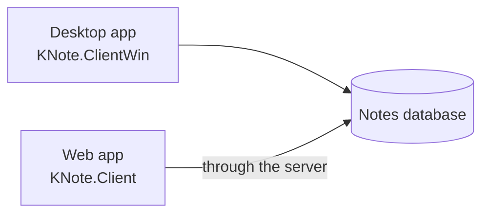

# KNote manual

## Introduction 

KNote is a minimalist note and task manager. Tasks or notes are stored in databases and can be organized in thematic folders. These notes can contain different resources (images, attachments, ...), link various alarms and be enriched with custom attributes. KNote also integrates a minimalist language with which you can automate tasks. In addition to the task manager, you can give KNote other uses, for example a small content manager.

Two different database engines are supported, Sqlite for personal tasks and SQL server for corporate use.

KNote also has two different front-ends, an old-school Windows desktop application (WinForm app) and a Web application (Blazor app). 


## User's Guide 

### Configuration files (desktop app)

The Windows desktop application keeps its configuration in the folder `%LocalAppData%\KNote`, in two XML files:

| File | What it holds | When it changes |
|---|---|---|
| `KNoteData.config` | What you configure: how you sign in, repositories (their names are kept in their databases, see *Repositories*), AI providers, e-mail (SMTP) account, alarm and auto-save options, chat room (its server and your sign-in token) and ServerCOM settings. | Only when you change a setting. |
| `KNoteState.config` | What KNote remembers by itself: last user name you signed in with (never the password), last active folder, window positions and sizes, list layout, visible panels, the rows of the alarms panel, and the last AI provider and view options of the AI assistant. | As you use the application. |

Deleting `KNoteState.config` only resets the window layout. Deleting `KNoteData.config` makes KNote start as if it were the first run: your databases are not deleted, but the list of repositories and AI providers is lost.

**Passwords and API keys.** The e-mail account password, the API keys of the AI providers (also the web search key of Ollama), the sign-in token of the chat room and the password inside a repository connection string (SQL authentication) are stored encrypted with Windows data protection, tied to your Windows user and this computer. Connection strings without a password (SQLite, Windows authentication) stay readable. If you copy `KNoteData.config` to another computer or user, those secrets cannot be decrypted: KNote tells you at startup which ones must be entered again, and everything else loads normally. A secret typed in plain text into the file by hand is accepted and gets encrypted the next time the file is saved.

**Backups.** Every time a file is saved, the previous version is kept next to it as `KNoteData.config.bak` / `KNoteState.config.bak`. If a file cannot be read, KNote loads its `.bak` and tells you.

**Upgrading from a previous version.** Older versions kept everything in a single `KNoteData.config`. The first time this version starts, it converts that file automatically into the two files above, keeping all your values (passwords and API keys are kept, now encrypted). A copy of the old file, **without** passwords and API keys, is kept as `KNoteData.config.v1.bak`.

**Going back to an older version.** Older versions cannot read the new files and will fail at startup. To go back: close KNote, keep a copy of the current `KNoteData.config` somewhere else, rename `KNoteData.config.v1.bak` to `KNoteData.config`, delete `KNoteState.config`, start the older version and enter your passwords and API keys again.

### Signing in, users and roles (desktop app)

**How you sign in.** By default the desktop app identifies you with your **Windows account**, without asking for anything (like the integrated security of SQL Server). In **Options → Sign in** you can choose **With a KNote user name and password** instead; the change applies the next time KNote starts (it offers to restart). From then on, KNote asks for a user name and password at startup, proposing the last user name used. The sign-in window also has a **Use my Windows account instead** link, which signs in with the Windows account and switches the option back.

**Each repository has its own users.** When KNote starts, and whenever you link or create a repository, it checks your user in that repository:

| Situation | What happens |
|---|---|
| You are registered there | The repository is linked. With a KNote user name, the password must also match. |
| You are not registered there | The **Register user** window asks for your full name and e-mail (and a password). If you sign in with a KNote user name, the password is the one you signed in with, so the same credentials open all your repositories. |
| Wrong password, user disabled, or registration cancelled | The repository is not available in this session. It stays in your configuration and is tried again at the next start; KNote tells you why once the main window opens. |

If none of your repositories accepts you, KNote lets you try again (signing in again with a KNote user name) or close.

**Roles.** Your role is per repository, so you can be an Admin of your personal repository and a Guest in a shared one. The roles are hierarchical: each one can do everything the previous ones can, and more.

| Role | What it adds |
|---|---|
| **Guest** | Browse folders and notes, search and filter, open notes to read them, link and unlink repositories, help and about. |
| **Staff** | Create, edit and delete notes (and their tasks, resources, alarms and trace notes), PostIts, move notes and change tags, print and export to CSV, application info alarms, options, AI providers, chat and AI assistant. |
| **Project manager** | Create, edit and delete folders, KntScript console and running the code of notes, KNote assistants of the catalog. |
| **Admin** | Manage the repository (users, note types, attributes, trace note types), create repositories, COM port server and lab tools. |

The options that don't belong to one repository (options, AI, chat, scripts, creating a repository...) use your highest role among your repositories.

**Who gets which role.** The first user who registers in a repository where `adminKNote` is still the only Admin becomes an Admin too: the creator of a new repository manages it. From then on, new users register as **Guest** until an Admin raises their role in **Repository → Users**.

**Where to see it.** The status bar of the management window shows your user, your role in the active repository (it changes as you move to a folder of another repository) and your application role, e.g. `jdoe · Personal repository: Admin · Application: Admin`. Its tooltip, above the status bar, shows how you signed in and your role in every linked repository; a double click opens **My profile**.

**Your profile and password.** **Tools → User** has two options, for any role:

- **My profile ...**: your full name and e-mail, as they are in the active repository. Only an Admin can change your user name. Changing the e-mail asks for your current password. **Save it in every linked repository** (checked by default; shown when there is more than one) saves them in all your repositories.
- **Change password ...**: your current password and the new one, twice. It changes in every linked repository, as each one keeps your user (signed in with a KNote user name, the same password must open all of them). If a repository refuses it (another password there, a disabled user...), the others change anyway and KNote tells you which; signed in with a KNote user name, that repository won't open in your next session until it has the same password.

A new password has at least 8 characters and can't be your user name, also when you register or an Admin sets it; the passwords set before keep working.

**Forgot your password?** The link of the sign-in window explains who can set a new one, as your user is kept in each repository and the desktop app has no e-mail to send a link from: an Admin of each repository (**File → Repositories → Edit repository properties → Users**, edit the user, **Reset password**); the web app's **Forgot your password?**, if the repository is also used by the web app; or your Windows account, if your repositories have that user.

**When an option isn't for your role.** All the menus stay available; choosing one your role doesn't allow just tells you which role it takes. A note opened by a Guest opens to be read: KNote says so, and changes can't be saved. Automatic processes (reopening PostIts, alarms, script alarms) skip the repositories where your role doesn't allow them.

**Upgrading from a previous version.** The first time a database is opened with this version it is updated automatically: the role *Public* is renamed **Guest** (so users registered as *Public* can only read until an Admin raises them to Staff), the typo *ProjecManager* becomes **ProjectManager**, and the demo user `owner` is deleted if it was never used. Older versions don't know the new role names; keep a copy of a shared database before opening it with this version.

These permissions are enforced by the application. Somebody who connects to the database directly, with its connection string, is not restricted by them: protect shared databases with the database's own permissions too.

### Repositories (desktop app)

A repository is a KNote database, SQLite or SQL Server. The **Repository** menu links an existing one, creates a new one or edits the properties of the selected one. Their **General** tab asks, in this order, for the type of database, where it is (directory and file for SQLite; server\instance and database for SQL Server), the resources container (its name, whether to save a copy of each resource in the database, its root folder and its root URL) and the repository's **Name**.

**The name is kept in the database.** The name you see in the folders tree, the status bar and the window titles is stored in the repository's own database, so everybody who opens it, in the desktop app or in the web app, sees the same name. You give it when you create the repository, and an Admin of the repository can change it in **Edit repository properties**. It can't be the name of another repository you have linked. When you link an existing repository the name isn't asked: it is the one in its database.

**One link per database.** Each database is also given an identifier of its own when it is created. A database that is already linked can't be linked again, nor can a copy of it (copying a database copies its identifier too): KNote tells you which repository it is. If two repositories of your configuration turn out to be the same database, only the first one is opened, and KNote tells you at startup.

**SQLite files.** KNote opens SQLite databases in WAL mode, so that several users of the web app, or several windows, can save at the same time. Next to the database file (e.g. `knote.db`) you will see two more files while it is in use, `knote.db-wal` and `knote.db-shm`: they belong to the database, don't delete them. To copy the database (a backup, another computer), close KNote and the web server first, so that everything is in the `.db` file. Keep SQLite databases on a disk of the computer that uses them, not in a network folder.

**Upgrading from a previous version.** Earlier versions kept the repository's name (its *alias*) in `KNoteData.config`. The first time this version opens a repository, its database takes that alias as its name (or, if there is none, the name of the database: the SQLite file or the SQL Server database), and the alias is removed from the file. A repository that can't be opened keeps its alias until it can. If another user already opened a shared database with this version, you see the name that user's alias gave it; an Admin can rename it.

### Notes list (desktop app)

**Refreshing the list.** **Edit → Refresh notes list** (`Ctrl+R`) reads the notes of the selected folder, search or filter again from the database and sorts them again. Use it after changing the field the list is ordered by (the priority, for instance): an edited note is updated in the list, but it isn't moved to its new place until the list is refreshed. The selected note stays selected.

**All the notes of a repository.** Clicking a repository's node in the folders tree (the one with its name in brackets) lists all of its notes. As that can take a long time in a large database, KNote asks first: **Cancel** leaves the notes list and the note viewer empty. Refreshing the list you have already loaded doesn't ask again.

**Safe notes.** A note's description can carry HTML (written in the HTML editor or in Markdown). To protect whoever reads it, KNote shows it without what could run code on its own (scripts, `javascript:` links, forms...), both in the desktop app and in the web app; the formatting (fonts, colors, tables, images, links) is kept.

### Diagrams in notes

A note written in Markdown can include diagrams (flowcharts, sequence, class or state diagrams, Gantt charts, pie charts...) described as text with [Mermaid](https://mermaid.js.org/): write the description in a code block whose language is `mermaid`. For example:

````markdown

````

Both apps draw it wherever the note is shown as it looks: in the desktop app, the note's view, its tasks and the post-it; in the web app, Home, the note view and the **Preview** of the description and of the tasks.

- In a label, `<br/>` starts a new line.
- If the description has an error, the block is shown as text, so you can see it and fix it.
- Diagrams follow the light or dark mode (in the web app they change with the theme). A note with colors of its own, shown on a white sheet in the dark themes of the web app, keeps its diagrams light.
- They are not drawn in the desktop app's HTML editor and Markdown view (they are text there), in prints and PDFs, or in the answers of the AI assistant and the messages of the chat room.
- No Internet connection is needed: Mermaid comes with KNote. A note with diagrams takes a little longer to show (about half a second); the others are not affected.
- They are safe to show: Mermaid draws them with its strict security level and, in the desktop app, the page of a note with diagrams can run only KNote's own scripts (a Content Security Policy).

### Printing and exporting (desktop app)

The **File** menu of the management window has these options (the three prints grouped in its **Print** submenu), all working on the notes list exactly as you see it: the notes of the selected folder, or the result of a search or a filter, in the order and with the columns shown on screen (including the compact view and the list filter).

| Option | Result |
|---|---|
| **Print > Notes list ...** | The list as a table, in landscape, headed by the folder path or a summary of the search/filter. All the visible columns fit the page width. The **Print** button of the toolbar does the same. |
| **Print > Notes list as book ...** | A book: a cover, a table of contents with page numbers and one chapter per note, in the order of the list. The chapter title is the note's topic and its text the note's description. A book of more than 100 notes can take a long time to generate, so KNote asks first. |
| **Print > Selected note details ...** | Everything about the selected note, as saved: properties, description, attributes, resources (with a thumbnail of the images), tasks and trace notes. The note's script and its alarms are not printed. |
| **Export notes list to CSV ...** | The same content as the printed list, as a CSV file. |

The note editor has its own **Print** button, which prints the details of the note being edited as you are seeing it. If it has changes not saved yet, the report says so.

**Preview, printer and PDF.** Every print opens a preview window first. From it, **Print ...** opens the print dialog (choose the printer, or *Save as PDF*, which also has its own page preview) and **Save as PDF ...** saves the report directly as a PDF file. The book takes a moment longer to open: it is paginated once to know the page numbers of its table of contents.

**CSV files.** The proposed file name describes the folder, search or filter of the list. The file uses the list separator of your regional settings (`;` in Spanish, for instance) and UTF-8 encoding, so Excel opens it directly with a double click. A text that starts with `=`, `+`, `-` or `@` (e.g. a topic like `- Quick links`) is written with a leading apostrophe, so that spreadsheets show it as text instead of trying to run it as a formula.

The save dialogs (PDF and CSV) start in the folder where you last saved one of them.

### KntScript console (desktop app)

**Tools → KntScript console** (Project manager role or higher) opens an editor for code on the left and its output on the right. The toolbar has:

| Button | What it does |
|---|---|
| **New**, **Open**, **Save** | Start empty code, open a code file (`.knts`, `.cs`, `.py`, `.js`, or `.txt` for a natural-language prompt) or save it. Opening a file selects its language from its extension. |
| **Insert code snippet ...** | Inserts at the cursor a code snippet of the catalog (the notes of type `@Code` of the Assistant repository, or of the active folder's repository if there isn't one), the same catalog as the note editor's **Insert code snippet ...**. It also selects the snippet's language. |
| **Language** | The language of the code: KntScript, C#, Python, JavaScript or Natural language. |
| **Run** | **Run in integrated output console** (`F5`) shows the output in the console itself, where you can also type the input the program asks for. **Run in standard output (stdout)** (`Shift+F5`) runs it in a separate system console window; it is only available for C#, Python and JavaScript. A natural-language prompt is sent to the AI assistant, which answers in its own window. |

If the code has changes that haven't been saved, **New**, **Open** and closing the window ask before discarding them.

### AI assistant (desktop app)

The AI assistant window shows the whole conversation in its upper area. Write a question below and click **Send**. The list next to **New session** chooses the AI model that answers. On the right, the **Sessions** panel lists your previous conversations (see *AI assistant sessions* below).

The assistant can also work with your notes: ask it to look for notes about something, to tell you what a note says, or to note down a task, and it uses the notes of its repository. A task it creates is saved in that repository (in your default folder if it is there, otherwise in its Home folder) and opened in the note editor, where you can change it, keep it or delete it. The assistant's own sessions and the chat room threads are left out when it searches your notes.

**Its repository.** The list **Sessions in the repository**, above the sessions panel, shows the repository the assistant works in: where its sessions are, the notes it searches and where it saves the tasks. It lists your repositories where your role is Staff or higher. Choosing another one starts a new conversation (KNote asks first if there is one) and shows that repository's sessions. The window's title and status bar show it too. The assistant opens in the repository you chose last (or, the first time, the one of the active folder).

The conversation can be seen in two ways, chosen with the buttons above it:

| Button | View |
|---|---|
| **Navigate** | As a chat (the default): your questions on the right, in a bubble, and each answer below with its text formatted (headings, lists, tables, code) and, at its foot, the tokens and the time it took. Links of an answer open in your web browser. |
| **Markdown** | The text of the conversation exactly as it is saved in its session note. Each question and answer is preceded by a hidden marker (`<!-- knt-ai:user -->`, `<!-- knt-ai:assistant {...} -->`) that note viewers don't show; the marker of an answer holds its tokens and time. |

The **Actions** menu repeats what the buttons and the list do: **Send** (`Ctrl+Enter`), **New session**, **Model** (the same models as the list), **Navigate view** and **Markdown view**. Its options are available exactly when their button is.

The **Options** menu has the rest:

| Option | What it does |
|---|---|
| **Get stream** / **Get completion** | How answers arrive: as they are being written (the default) or all at once when they are complete. |
| **Get prompt from catalog ...** (`Ctrl+K`) | Starts a new conversation from a prompt of the catalog. |
| **View system root ...** | Shows the instructions the model receives before the conversation. |
| **Show model info (tokens, time)** | Shows or hides, below each answer of the chat view, the tokens and the time it took. The Markdown view always has them, in the marker of each answer. |
| **Manage models ...** | Adds, changes or removes the AI models (providers) you can choose. |

Sending a question keeps the view you are in. KNote remembers the view and the **Show model info** option for the next time you open the assistant. The assistant opened from the menu also remembers its window's position and size, the width of the **Sessions** panel and the height of the question box. The tokens are the ones reported by the AI provider; when a provider doesn't report them, they are estimated (the chat says so). If an answer fails halfway, what arrived of it is marked as failed and is not part of the conversation: it disappears when you send the next question. If an answer reaches the maximum length a model can write in one answer, the chat view ends it with a notice saying it was cut (shown even with **Show model info** off): ask the assistant to continue. **New session**, changing the AI provider or choosing a prompt of the catalog start a new, empty conversation; the current one is already saved.

### AI assistant sessions

Every conversation with the AI assistant is kept as a **session**, so you can come back to it later, in the desktop app or in the web app: both use the same sessions.

**Where they are kept.** Each session is a note of the repository you are working in, of the note type **`@ChatSessions`**, in the folder **AI Assistant sessions**. The note's topic is the first line of your first question, its description is the conversation (as the Markdown view shows it), its attributes **AiProvider** and **AiModel** say which AI model answered, and a task assigned to you, starting when the session began, links it to you. The note type, its two attributes and the folder are created the first time you open the assistant in a repository that doesn't have them.

**When they are saved.** After every answer. If saving fails, KNote tries again before you leave the conversation (a new session, another session, another provider, closing the window) and, if it still can't, asks you whether to discard its last messages.

**Going back to a session.** The **Sessions** panel lists your sessions, the most recent first; choose one to see it again and go on with it. It continues with the AI model it was held with; if that model is no longer configured, it continues with your default one and KNote tells you so. The panel only lists your own sessions, and only you can open or continue them from the assistant.

**Privacy.** Sessions are ordinary notes: anybody who can browse the **AI Assistant sessions** folder of a shared repository can open them as any other note. Don't write in a conversation anything you wouldn't write in a note of that repository.

**Desktop app.** Sessions are kept only when you open the assistant from the menu. When a KntScript script or a note's natural-language code (`ln`) uses the assistant, nothing is saved (a script can turn it on with `PersistSession = true`). The **Sessions** panel is hidden then.

### Search by meaning (KNote Atlas)

Besides searching by words, KNote can find notes by **what they talk about**, even when they don't use the words you remember. It works with an **embedding model**: an AI model that turns a text into a list of numbers that represents its meaning, so that texts that say similar things get similar numbers. KNote calculates those numbers for every note once (the repository's **semantic index**) and compares them with the ones of what you search.

To use it you need three things, in this order: an embedding model in your installation, the repository's models declared by an Admin, and the semantic index created by an Admin. Until then, the options of this section don't appear: everything works as always.

**1. The embedding model of your installation.** An embedding model is configured as an AI provider whose **Kind** is **Embeddings** (the AI assistant's models are of the kind **Chat**). Only Ollama and OpenAI have embedding models; Anthropic doesn't.

- Desktop app: **Tools → Manage AI providers**.
- Web server: the `ai` section of the server (see *AI providers of the web app (server configuration)*).
- KNote Local: **Admin panel → This computer → AI providers**.

The **Test** button of each provider checks it: with an embedding model it calculates a test vector and shows its dimensions and the time it took, and it explains the usual errors (the model is not downloaded, the host doesn't answer, the API key is not valid). With Ollama, download the model first, for example `ollama pull qwen3-embedding:0.6b`. Local models are recommended for privacy: with a paid model (OpenAI) the content of your notes is sent to its provider. The **Context size** field is only for the chat models of Ollama (empty: the model's own), as the optional **Web search API key** (of an ollama.com account, only for searching the Internet from the assistant): with it, **Test** also makes a search and says whether the key works.

**2. The repository's models (Admin).** They are the same for everybody who works with the repository, in either app:

- Desktop app: **File → Repositories → Edit repository properties**, tab **KNote Atlas**, and **Save models**.
- Web app: **Admin panel → KNote Atlas**, section **Repository models**, and **Save models**.

| Field | Meaning |
|---|---|
| **Embedding model** | The model all its notes are indexed with (e.g. `qwen3-embedding:0.6b`). Empty: no search by meaning in this repository. Every installation that works with the repository needs a provider with this model. |
| **Dimensions** | Empty: the model's own (recommended). Fewer make the index smaller, only with models made for it (Qwen3-Embedding, OpenAI `text-embedding-3`). |
| **Query instruction** | A sentence that tells the model that what it receives is a search, for models that expect one, like Qwen3-Embedding (e.g. *Given a search query, retrieve the notes that talk about it*). Leave it empty with OpenAI. |
| **Recommended LLM** | Optional: the chat model recommended for the AI tasks of the repository. |

Each model warns if this installation doesn't have it and if it is a paid one.

**3. The semantic index (Admin).** In the desktop app, tab **Semantic index** of the same window; in the web app, section **Semantic index** of the **KNote Atlas** tab. It shows how the index is (notes indexed, pending and fragments; when it was last created and how long it took). **Create index** calculates the meaning of every note: KNote tells you first how many notes it will send to the model and, after the first time, how long it should take. You can go on working (in the desktop app you can even close the window: the status bar shows the progress); **Cancel** (**Cancel run** in the desktop app) keeps what is done, and the next run goes on from there. The notes that fail are listed and tried again in the next run. In the web server one index is created at a time, whatever the repository: the others wait, **Queued**.

- Each note is indexed in fragments: its data (topic, type, folder, tags, attributes, resources), its text by its sections, each task, and each resource that has a description. The notes of the assistant's sessions, the chat room and the search evaluation are left out.
- A note you change becomes *pending*. The pending notes are brought up to date before each search by meaning (a few at a time: up to 50 notes or about 10 seconds) or with **Update now**. A very long note (with more than 64 fragments to calculate) is left for **Update now**: until then, the search uses its previous content.
- **Rebuild** calculates every vector again (after changing the dimensions, for example); meanwhile the search goes on with the old ones.
- **Changing the embedding model** needs the index of the new model. The index of the previous model is kept (to compare them, see *Search evaluation (web app)*) and listed below; an Admin can remove it.

**Searching by meaning.** In the desktop app's **Search panel**, choose **Search by: Meaning**; in the web app's **Quick search**, the **Meaning** button next to **Words**. The two ways are separate, and **Words** works exactly as always:

- By meaning you get the **100 most similar notes** at most (with a similarity of 0.45 or more), the most similar first, all at once. The list has two more columns: **Similarity**, from 0 to 1 (1 would be the same text), and **Fragment**, the part of the note that matched. You can sort it by any column, as always.
- Write what you are looking for as you would tell it to somebody: *how to connect the computer to a modern screen* finds better than a list of loose words. `#123` and `!word` are only for **Words**.
- If some notes are not up to date yet, a notice above the list says so, with **Update index**: they may be missing or found by their previous content.
- In the **notes filter** of both apps, the field **Talks about…** does the same among the notes that meet the rest of the filter.
- Printing and exporting a list found by meaning include its **Similarity**.

**Similar notes.** The **Trace notes** tab of the note editor (in both apps) shows, below the note's relations, the notes that talk about the same as this one: up to 10, with a similarity of 0.60 or more, leaving out the notes already related to it. A note marked **Possible duplicate** (0.95 or more) is almost the same. Double click a note to open it; **Relate** relates it to the note you are editing. In the web app, the **Similar notes** button of the note viewer and of the lists' preview shows them too. They are calculated each time: nothing is saved.

### Search evaluation (web app)

**Search evaluation**, a button of the **KNote Atlas** page (ProjectManager role or higher), measures how well the search works in a repository: whether the search by meaning finds what you look for better than the search by words, and which embedding model finds it better. It is a laboratory: use it when you choose a model or after changing how the search works.

1. **The test queries.** They are kept in the note **Search test queries**, in the folder **KNote Atlas** (created the first time you open the page). **Open in the editor** opens it: write a table with one search per row, the notes it should find, and, optionally, the words you would use to search by words:

   ```markdown
   | Query | Expected notes | Words (optional) |
   |---|---|---|
   | how to connect the computer to a modern screen | #151, #158 | VGA |
   ```

   Write searches you really do, with your own words, without looking at the notes; about 30 are enough. **Read again** reads the note after saving it, and lists the rows with problems (no query, a note that doesn't exist...).
2. **The indexes.** Choose the indexes to compare (only those whose model this server has). To compare two models, create the index of each one: change the repository's embedding model, create its index and change it back (both indexes are kept). **Also without the query instruction** measures each index without it too.
3. **Evaluate** runs every search by words and by meaning in each index; **Cancel** stops it and shows the report of the searches done.

**The report.** For each kind of search, a summary:

| Column | Meaning |
|---|---|
| **In the first 10** | In how many searches an expected note is among the first 10 results: what you see without scrolling. The main measure. |
| **Expected notes in the first 10** | How many of all the expected notes are among the first 10 results (not only the first one). |
| **Found** | In how many searches an expected note is found, in any position. |
| **Mean position** | The average position of the first expected note: the lower, the better (1 is "always the first one"). |
| **Similarity of the first expected** | By meaning, the average similarity of the first expected note, in the searches where it is found. |
| **Similarity of the result 10** | By meaning, the average similarity of the tenth result: where the first 10 end. If it is close to the one above, the expected notes are not much more similar than the rest. |
| **Mean results** | How many notes each search gives, on average. By meaning, many results mean that the similarity it starts from lets in notes that have nothing to do with the search. |
| **Mean time** | How long each search takes, on average (by meaning, the vector of the search and the ranking). |
| **Errors** | Searches that failed. |

**If the minimum similarity were…** shows, for each index, what the search by meaning would give if it started from a higher similarity (0.50, 0.55, 0.60): in how many searches an expected note would still be among the first 10, and how many results each search would give on average. It helps to choose a minimum that leaves out the notes that have nothing to do with the search without losing the ones you look for.

Below, each search shows the position of its first expected note in each kind of search and, by meaning, its similarity, for example «3 (0.62)» (in bold if it is beyond the first 10; «—» if it wasn't found). Keep in mind that the search by words orders its list by topic, not by how much each note has to do with the search. **Save as note** keeps the report as a note of the folder **KNote Atlas**.

### The context of the AI: profile, glossary and task instructions (KNote Atlas)

The AI assistant of both apps answers better when it knows what your repository is about. Three notes of the folder **KNote Atlas** tell it, and it receives them in every question:

- **Repository profile**: what the repository is for, who uses it, what there is in each folder and each note type, your conventions... in plain words and in your own language.
- **Glossary**: a table with the terms, acronyms and proper names of the repository, what they mean and other ways of writing them (`| Term | Meaning | Also written as |`). The AI only receives the terms that appear in the conversation.
- **Task instructions**: how you want the AI to do a task in this repository (for now, the task **Assistant**). With the mode **Add**, they are added to KNote's instructions (and you keep the improvements of new versions of KNote); with **Replace**, they take their place. KNote's fixed rules (citing the notes with `#123`, not inventing, the user's permissions) always stay.

Everything is together in **KNote Atlas**: **Tools › KNote Atlas** in the desktop app, a window with a tab for each part and a list to choose the repository (it starts in the one of the active folder; the assistant has its own), and **KNote Atlas** in the side menu of the web app, a page with the same parts, for the repository of your session:

- The first time, **Create the profile** / **Create the glossary** (or **Customize** in the task instructions) creates the note with a template and opens it in the note editor of always. Afterwards, **Open in the editor** opens it. The help of the templates are hidden comments (`<!-- ... -->`): you see them while editing, they are not shown in the viewers and the AI never receives them; neither the sections left empty.
- **Fill in folders and types** (profile) adds to its sections *Folders* and *Note types* the folders of the first two levels and the note types that have notes, so that you only write what each one is. It only adds what is missing: nothing written is removed.
- **What the AI receives** shows the text the AI gets for a task, with its size (about how many words and tokens) and its parts (Staff role or higher). Write a test text and press **Show its terms** to see which glossary terms would go in. In the desktop app's assistant, **View › What the AI receives** shows it for the current conversation.
- In the desktop app, a prompt chosen with **Select prompt** (or given by a script) replaces only the assistant's instructions in that conversation: the fixed rules, the profile and the glossary stay.

Anyone can open KNote Atlas and read the notes; only a **ProjectManager** or an **Admin** can create, save, delete, move or retag them (also the note **Search test queries**). The profile is cut to about 2,000 words: KNote Atlas tells you if it is longer.

### What the AI assistant can look up (KNote Atlas)

The assistant of both apps reads the repository on its own, without asking, because it only reads. Besides searching notes by words and reading a note, it can:

- **search by meaning** (only if the repository has a semantic index): "do I have anything about the French Revolution?";
- **filter** by folder, note type, tag, user with a task, creation or modification dates and the value of an attribute: "the notes of the Invoices folder modified in September";
- see the **folders tree**;
- see the **tasks, alarms, resources and relations** of a note;
- list the **tasks of a period**, of everyone or of one person: "what tasks does Marta have this week?";
- look up terms in the **glossary** (only if it has terms).

While it answers, both apps show the tool it is using (**Using find_notes_about**, for instance), until it starts writing.

**Thinking.** Many models reason before answering, and a local model can take a minute or more even with a simple question. Meanwhile you see **Thinking…**. Above the answer there is a folded section, **Reasoning** while it arrives and **Thought for 63 s** when it ends: open it to read what the model thought, also while it is thinking. It isn't saved with the conversation, so it isn't there when you resume a session, and it isn't sent to the model again. When the provider tells them apart, the usage line of the answer also shows the reasoning tokens. Reasoning takes room in the context of the model: with a small **Context size** in a local model, the answer may come cut.

You name folders, note types, users and attributes as usual: if a name doesn't exist or could be several, the assistant gets the options and can ask you which one. KNote's own notes (AI sessions of any user, chat room threads, profile, glossary, instructions and test queries) are never within its reach. Of a very long note it reads the first 40,000 characters, and it knows the rest is missing. Small local models may choose the wrong tool now and then: asking again more concretely usually helps.

**Asking it to act.** The assistant can also write in the repository, with your permissions and never deleting anything. It creates a note at once and shows it ("Write this down in a note in the Sinclair folder"). Changes to what already exists are only proposed: adding text at the end of a note ("Add to note #340 what we have said"), replacing the whole text of a note ("Replace the text of #340 with this one: ..."), moving a note to another folder ("Move #340 to the Sinclair folder"), adding or removing tags ("Tag #212 as *restored*"), adding a task ("Add to #212 a task for Luis: check the PSU before Friday"), adding an alarm ("Remind me on Monday at 9 to review #212", "...in two hours", "...every Monday"), changing an attribute ("Set the Status of #212 to *Working*"), relating two notes ("Relate #512 to #498") and creating a folder ("Create the folder Topic 5 inside History"). A card appears in the conversation with each change, which you can unmark, and **Accept** and **Reject**. Nothing is changed until you accept. If you accept, the assistant goes on by itself; if you reject, it waits for your next message. **Don't ask again for tags in this conversation** (the box names what it covers) skips the card only for the kinds of change you accept in that card, and only in this conversation: if you approve tags, adding text to a note still asks. Writing a new message without answering the card rejects what it proposed, and a conversation closed with a card unanswered shows it as **Not confirmed**: it is never done later. Changes to a note created in this conversation need no card. Each thing done stays in the conversation, with links to its notes, and you see it when you resume it from either app. A locked note can't be changed, and in the desktop app neither can a note open in an editor: close it and ask again. In the web app, an editor open with that note warns you that it was changed elsewhere and that saving it may replace those changes: close it and open it again.

**Alarms, tasks and folders.** The assistant only sets alarms for you, and it can give a task to any user. It sends an alarm by email only if you ask for it; that alarm always shows a card, even in a new note, and it is only sent if KNote's email alarms are on. Check the date on the card: it shows the day of the week so that you can see at once whether the model worked it out well. Creating folders needs the Project manager role or higher: otherwise the assistant tells you that you can't, and shows no card. A new folder appears in the folders tree when you use **Refresh tree**.

**Replacing the text of a note.** This is the only thing the assistant can do that loses text, and it can't be undone: KNote doesn't keep earlier versions of a note. So it shows a card, even in a new note, with the new text (up to 4,000 characters) and how many characters the note has and will have: read it before accepting. With **Don't ask again**, it replaces text without a card for the rest of that conversation. Only the text changes, not the title, the tags or anything else. If somebody changes the text while the card is waiting, nothing is replaced and the assistant tells you so.

**Opening a note.** Ask the assistant to open a note ("Open #340 in its editor") and you get its edit form, to see it or change it by hand. A note it creates doesn't open by itself, because in the desktop app a note open in an editor can't be changed: ask for it ("...and open it"). In the web app it opens in a window, and if the browser blocks it you have a link in the conversation.

**If there is no card, nothing was done.** A small local model may now and then say that it proposes or has done something without really doing it. What counts is the card or the **✔** line: without them, ask again.

**Images and files.** You can attach up to 5 files to a message, of 5 MB at most each: with the **Attach** button, pasting them (Ctrl+V) or dropping them on the message box. With an image you can ask about it, have it described or transcribed ("What model is it?", "Copy what this whiteboard says"). The assistant sees it in that message only; afterwards it works with what it answered. Big photos are reduced for the model, and the original is saved intact with the conversation, which shows it again when you resume it in either app. Only you see the images of your conversations. The assistant can't read other files such as PDFs yet: they are only saved with the conversation. If the model can't see images, KNote tells you when you attach one, and with a paid provider it reminds you that images are sent to it. In the desktop app you can attach files only in conversations that are saved (the assistant opened from the menu), not in the ones a script opens.

Ask for it to keep a file in a note ("Attach this photo to #340"): it shows a card, as any change to a note that already exists; in a new note it doesn't ask, so you can say "Create a note with what this whiteboard says and attach the photo". It can also look at the photos a note already has ("Describe the photos of #340", "In which of the photos of #512 is the motherboard?"), and again at an image of the conversation ("Look at the first photo again"). It looks at 3 at a time, and it tells you how many there are.

**Searching the Internet.** Turn on **Internet** (the globe button next to **Attach**; in the web app, the globe next to the clip) and the assistant can search the Internet when the answer isn't in your notes, or to complete or check them: "Search the Internet for the release date of the Amstrad CPC 6128 and compare it with my note", "Find the service manual of the MSX and save the link in its note". Without it the assistant can't search, and it tells you so if you ask; an answer may still come from what the model knows, which isn't what the Internet says today. It is off in every new or resumed conversation, and it is only there with a provider that can search: OpenAI and Anthropic search themselves; with Ollama, KNote searches with the web search of ollama.com, which needs the **Web search API key** of an ollama.com account in the Ollama provider (the model still runs on your computer). While it is on, a line under the message box reminds you that what is searched leaves the computer, also with a local model; Anthropic bills each search. What it takes from the Internet comes with its link (marked with ↗, and opened in another tab of the browser in the web app), different from the citations of notes: when the provider gives its sources apart, they are added at the end of the answer under **Sources**. Saving something it found in a note follows the cards as any other change, and what a page says is never an order for the assistant.

**Citations.** A `#123` in a note, in a task or in an answer of the assistant is a link to that note, shown differently from web links. In the web app it opens the note's viewer in a window; in the desktop app, the note editor. Any `#` followed by a number is a link, without checking that the note exists: when it doesn't, or it is one of KNote's own notes, you get **Note #123 not found**. They aren't links inside code, in the desktop app's HTML editor or in the chat room.

**Modified between.** The notes filter of both apps has this line: the notes modified between two dates, both included. Either of them can be left empty.

### Chat room

The chat room lets the users of a KNote web server talk in **threads**: each thread is a conversation about one topic, and every user with the Staff role or a higher one in that server can read it, join it and write in it. The web app and the desktop app share the same chat room, the one of the web server: a message written in one appears at once in the other.

**Where threads are kept.** Each thread is a note of the web server's repository, of the note type **`@KNoteChatRoom`**, in the folder **KNote Chat Room**; the note type and the folder are created the first time the chat room is used. The note's topic is the thread's topic and its description is the conversation, in Markdown, with a hidden marker before each message (`<!-- knt-chat:message {...} -->`) that holds who wrote it and when. Whoever creates a thread, writes in it or sends an image to it gets a task in its note that links them to it: they are its participants. Each message is saved as soon as it is sent.

**Following threads.** While you are connected you *follow* the threads you take part in and the ones you open: their new messages arrive at once, and the ones of a thread you aren't looking at are counted as new in the threads list (the thread is shown in bold). The new messages of the threads you don't follow are counted too. **Stop following** stops receiving the messages of the thread shown until you open it again. The header of a thread shows who is in it now.

**Messages.** They are written in Markdown (bold, lists, code, links...): **Enter** sends the message and **Shift+Enter** starts a new line. For your safety, any HTML that a message contains is shown as text. Links open in your web browser.

**Images.** Paste an image into the message box or drop it (png, jpg, gif or webp, up to 5 MB) and it is sent to the thread shown. Each image is kept as a resource of the thread's note, in the resources folder of the web server (the same as the images of the notes, so the server needs its resources settings: `ResourcesContainer` and their folder and url), and is sent as a message. Click an image to see it at its size.

**The General thread.** A KntScript script that sends a message (`SendChatMessage`, or `SendMessage` of the chat controller) with no thread shown writes in the thread **General**, which is created when it doesn't exist.

**Privacy.** Threads are ordinary notes: anybody who can browse the **KNote Chat Room** folder of the server's repository can open them, and their images are served as files of the server, like the images of the notes. The chat room threads are left out when the AI assistant searches your notes.

### Chat room (desktop app)

**Signing in to the chat room's server.** The desktop app works with its own repositories, so it signs in once to the web server of the chat room: in **Options**, tab **Chat room**, enter the **chat hub url** (the address of the web server ending in `/chathub`, e.g. `https://server/KNote/chathub`), your **user name** and **password** in that server, and click **Sign in**. KNote checks them and connects to test them; then it keeps only the sign-in token the server gives (encrypted, like the other secrets of `KNoteData.config`) and forgets the password. **Accept** the options to keep it. The token lasts a year: if the server refuses it (it expired, your password or your role there changed...), sign in again. **Sign out** forgets it, and so does changing the url.

**A server with several repositories.** Each repository of the web server has its own chat room. If your user and password are valid in more than one, **Sign in** signs you in to all of them at once (one token for each one is kept, still without the password), and the status below lists them. The chat room is chosen in its window: the list **Chat room of the repository**, above the threads, connects to the chat room of another repository without asking for the password again; KNote remembers your choice. Only the chat room connected tells you about its new messages. These are repositories of the web server, not the ones linked in the desktop app. After upgrading the server to the version with several repositories, sign in again here once: the earlier tokens are refused.

**The window.** **Chat room ...** in the menu opens it. When the app starts, it connects in the background with the window hidden, and shows the window when somebody else writes in a thread you follow; closing the window only hides it. On the left, the conversation of the thread shown and, below it, the message box; on the right, the **Threads** list (**New**: the messages that arrived since you last saw it; **Activity**: its last message). **New thread** asks for its topic; **Stop following**, above the conversation, also shows who is in the thread now; **Image ...** chooses an image to send. The status bar shows the connection, your user and the server. The **Actions** menu repeats them: **Send** (`Ctrl+Enter`), **Send image ...**, **New thread ...**, **Stop following the thread** and **Reconnect**. KNote remembers the window's position and size, the width of the threads panel and the height of the message box.

**Images.** `Ctrl+V` in the message box sends the image of the clipboard (a screenshot, for example) or the image files copied in the file explorer; image files can also be dropped on the message box, or chosen with **Image ...**.

If the connection fails when the app starts, KNote tells you without interrupting and stops connecting at startup until you sign in again from **Options**.

### Chat room (web app)

**Chat room** in the side menu (Staff role or higher) opens the chat room page: the conversation of the thread shown on the left, with its participants and who is online now, and the **Threads** list on the right, with the new messages of each one. Drag the bar between them to resize them (the browser remembers it). The header shows the connection's state, **Stop following**, **New thread** and the button that opens the chat room in a new window.

The web app connects to the chat room when you sign in and leaves it when you sign out, so while it is open you are told about the new messages of the threads you follow, even on other pages. Images are pasted into the message box or dropped on the conversation; clicking one opens it in a new tab.

**In its own window.** The button that opens it in a new window moves the chat room, with the thread shown, to a window of its own, without the app's menus, so you can keep it next to your work; the main window goes back to Home. There is only one chat room window: opening it again brings it to the front. The main window keeps following your threads, so it still tells you about their new messages. If the browser blocks the window, allow pop-ups for the app's site.

### Home (web app)

Home is the first page of the web app, and it can be seen without signing in. Its header shows the repository's name, the same one as in the desktop app; on the other pages the top bar shows it after *KNote* (on a phone there is only room for *KNote*). Without signing in, it is the server's default repository; once you are signed in, the repository you chose (see *Signing in and repositories (web app)*).

Home shows the notes of the repository's **Home** folder, by priority and topic, 25 at most. When Home has folders inside, a panel at the right of the notes lists them after **Home**: choose one to see its notes, with the same order. Home remembers your choice while the app is open. On a phone the panel is a row above the notes.

Only the folders directly inside Home are listed there, and anybody can open them and their notes without signing in, like Home itself: keep there only what can be public.

The web server names a new database with the `Name` setting of its repository (see *Repositories of the web server (server configuration)*); the old `Alias` setting is still read.

### Notes lists (web app)

The **Tree panel**, **Notes filter** and **Quick search** pages show their notes in the same list, with the columns of the desktop app's notes list. It fills the window and loads more notes as you scroll; the total is shown above it. The **View options** menu of the page header groups the ways of looking at the notes: **View note**, **Show preview** / **Hide preview** and **Extended list** / **Compact list**. **Extended list** / **Compact list** switches between all the columns and the compact view (number, topic, priority and tags), which is the default; the choice applies to the three pages and the browser remembers it. The topic column keeps a minimum width: in a narrow window the list scrolls sideways. In the tree panel, the folders tree has its own scroll.

**Selecting and opening.** A click (also a right click) selects a note, which is highlighted; a double click or **Enter** edits it (users who can't edit view it). The arrows, **Page Up**, **Page Down**, **Home** and **End** move the selection. Coming back to the page (e.g. from the side menu), the list is where you left it, with the same note selected.

**Actions.** The **Edit note** and **Delete note** buttons of the page header, and **View note** in its **View options** menu, act on the selected note. A right click on a note, the context menu key or **Shift+F10** show its actions (**View**, **Edit**, **Delete**), and **Delete** deletes the selected note after confirming it. The notes of **Home** show their actions in a **⋮** menu. As in the desktop app, all the actions are always available: choosing one your role doesn't allow just tells you which role it takes. Creating, editing and deleting notes need the Staff role or a higher one.

**Folders.** In the **Tree panel**, the **Folder** menu of the page header creates a folder inside the selected one (**New folder**), edits or deletes the selected folder and reads the folders tree again (**Refresh tree**); a right click on a folder of the tree shows **Edit folder** and **Delete folder**. Managing folders needs the ProjectManager role or a higher one.

**Preview.** **Show preview** / **Hide preview**, in the **View options** menu, shows, at the right of the list, the note that is selected; it changes as you select another one, and shows the note's changes when it is saved in its window. The pane can be resized with the bar between it and the list. The choice applies to the three pages and the browser remembers it, as well as the sizes you give to the panes of each page.

**Note windows.** Viewing, editing or creating a note (**New note**) opens it in a window of its own, without the app's menus, so you can keep it next to the list; new windows open in cascade from the main one. Each note has one view window and one edit window: opening it again brings that window to the front. Each **New note** opens a new window, in the folder selected in the tree panel; once saved, it is that note's edit window. When a note is saved in its edit window, the lists, Home and the note's view window show it changed. The exit button of the edit window closes it, asking first if there are unsaved changes (as does closing the window). If the browser blocks the window, allow pop-ups for the app's site. The chat room and the AI assistant can also be opened in a window of their own (see their sections).

**Admin panel.** The lists of users, note types, trace note types and attributes work the same way: a click selects a row, the **Edit** and **Delete** buttons of the header act on it, a right click shows the same actions and a double click edits the item. Those lists sort by clicking their headers and scroll on their own. In **Folders management**, the header buttons edit or delete the selected folder; a right click on a folder shows the same actions and a double click edits it.

**Sorting.** Clicking a column header sorts the list by that column; a second click reverses the order and a third one goes back to the list's own order. In the tree panel each folder opens in its notes order, as in the desktop app: by note number, a fixed order, or, when the folder follows the last order used, the last one chosen in either app (sorting the folder's notes saves it). The notes order of a folder is set in its edit form (**Folders**), with the same options as in the desktop app.

**Coming back to the list.** After opening a note, the list is shown again as it was: the same folder, filter or search, the same order and position, with a mark on the left of the note you opened.

### Printing and exporting (web app)

The **Print/Export** menu of the **Tree panel**, **Notes filter** and **Quick search** pages has the same reports as the desktop app. They work on the whole list of the page (all its notes, not only the ones loaded on screen), in the order and with the columns it shows (compact or extended view). They need the Staff role or a higher one.

| Option | Result |
|---|---|
| **Print list ...** | The list as a table, in landscape, headed by the folder path or a summary of the search/filter. |
| **Print as book ...** | A book: a cover, a table of contents and one chapter per note, in the order of the list. The chapter title is the note's topic and its text the note's description. The table of contents links to the chapters but has no page numbers: the browser can't know them before printing. A book of more than 100 notes can take a long time to generate, so KNote asks first. |
| **Print note details ...** | Everything about the selected note, as saved: properties, description, attributes, resources (with a thumbnail of the images), tasks and trace notes. Available when a note is selected. |
| **Export to CSV ...** | The same content as the printed list, as a CSV file that the browser downloads. |

**Preview, printer and PDF.** Every print opens a preview in the app, which shows the report as soon as it is generated; closing it before cancels it (useful with a large book). **Print ...** opens the browser's print dialog for the report only: choose the printer, or *Save as PDF*. The running header and the page numbers are drawn by Edge and Chrome; other browsers may leave them out. The links of a report open in a new tab.

**Language and CSV files.** Dates and numbers are written as your browser's language writes them, and the CSV file uses its list separator (`;` in Spanish, for instance) and UTF-8 encoding, so Excel opens it directly. As in the desktop app, the proposed file name describes the folder, search or filter of the list, and a text that starts with `=`, `+`, `-` or `@` is written with a leading apostrophe.

### Note editor (web app)

A note is edited in its own window. Its header shows the note's number (*New* until it is saved) under its icon, and its topic and, below it, the full path of its folder, its type and its tags, with **Save and new**, **Save** and the button that closes the window (it asks first if there are unsaved changes).

- **Overview**: the topic and the description and, at the right, the note's details (folder, type, priority, tags) and its record (number, dates, status). The description is written in Markdown, with a toolbar for its formats (headings, bold, lists, tasks, links, images, tables...): each tool works on the selected text or lines, and clicking it again removes the format. `Ctrl+B`, `Ctrl+I` and `Ctrl+K` make bold, italics and a link; **Link** and **Image** write the link with its address selected, ready to type it (if the selection is an address, its text is selected instead). `Ctrl+Z` and **Undo** undo the tools too. Typing is as fast with a long note as with a short one. **Preview** shows it as it looks. The browser remembers which of the two you use.
- **Locked content**: the **Content** switch of the record locks the note's description: it is shown, not edited, until it is unlocked. The lock is saved with the note, and it is the same one the desktop app sets.
- **Attributes**: the fields of the note's type and the general ones; the required ones are marked with an asterisk.
- **Resources**: the note's files as cards. Click a resource to see it in the note's window, without leaving it: images (click the image to see it at its size), PDF, video, audio and text files; the other files open in a new tab of the main window. Any file can be edited (its description and its order, not the file itself), opened in a new tab, inserted in the description (where its cursor was, in a paragraph of its own; at the end if it wasn't used) or deleted. **Add resource** uploads a file: drop it on the box, paste it or click to choose it.
- **Tasks**: as in the desktop app, the list of tasks (by priority) and, beside it, the task selected: who it is for, its priority, dates and times, and its description shown as it looks (it may be long, with images). Drag the bar between them to resize them (the browser remembers it); in a narrow window the task goes below the list. A resolved task is marked as such, and its text reads as the others. **Add task**, **Edit** or a double click open the task: its topic, its user, its description (Markdown, with **Preview**), its planning and its progress. A new task is yours, after the others and started now; resolving a task without an end date sets it to now.

- **Alarms**: the note's alarms, the same ones as in the desktop app, by date: when each one is due, how often it repeats, how it is notified, for which user, whether it is activated and its comment. **Add alarm** opens a new one for you, now, notified as *Application info*; **Edit**, a double click or **Enter** open an alarm, and the delete button removes it (it asks first). In the alarm: its **Date and time**, **Repeat** (once, every day, week, month or year, or every few minutes, which asks for the minutes), **Activated** (a deactivated alarm is kept but never notified), **Notification**, **User** and **Comment**. The four notifications of the desktop app are there: the web app notifies *Application info* alarms (see *Alarms (web app)*), *Email* alarms are sent by the server when it has them on (see *E-mail alarms sent by the server (server configuration)*) or by the desktop app, and *Post-it* and *Run KntScript* alarms are only processed by the desktop app. An alarm is saved at once, without saving the note; the dialog stays open if the server refuses it.

- **Trace notes**: as in the desktop app, the relations of the note with other notes, in two lists: **Trace notes from** (other notes that lead to this one) and **Trace notes to** (other notes this one leads to). Each relation shows the other note (number, topic and tags), its type, its order and its weight. **Add** opens the relation: the other note, chosen with **Select** (a text search, or browsing the folders tree; the note itself can't be chosen), its **Type** (optional; the types are managed in the admin panel), **Order** and **Weight**; the dialog shows the direction of the relation. The same two notes can be traced only once in the same direction with the same type (with no type too). A relation is saved at once, without saving the note. **Edit**, the button that removes it (it asks first; the other note is not deleted) and the one that opens the other note in its own window are on each row; a double click also opens it.

A new note has to be saved before adding resources, tasks, alarms or trace notes to it, and deleting a resource, a task or an alarm asks first. The dialogs of the admin panel (users, folders, note types, trace note types, attributes) and the sign in and register ones follow the same style: labels above the fields, grouped in sections.

### Alarms (web app)

While you are signed in as Staff or higher, the web app checks your *Application info* alarms every minute (the server decides how often) and tells you when one is due: with a notice at the top right while the app is on screen (clicking it opens the note), or as a notification of your system while it is not, if you allowed it. Each alarm is notified once, in one place: if the desktop app or another tab of the web app gets it first, it is not notified again (another tab of the web app shows it in its panel too).

The notices stay in the **Alarms** panel, opened with the bell of the header, which shows how many there are, until you remove them: each one with the note's number and topic, the alarm's comment, when it was due and when you were told. Clicking the topic opens the note in its edit window; the **×** button removes a notice, and **Remove all** removes them all (it asks first). **Allow** asks the browser to let the web app show notifications of the system (once; if you blocked them, the panel says so and you can allow them again in the browser's settings for the site).

The notices are kept in this browser, one list for each repository and user, like the desktop app keeps the rows of its alarms panel in your user folder: they are shared by the tabs of the app, but not with another browser or computer. A notice of an alarm that was deleted, or changed to another user or another kind of notification, disappears the next time the app is opened. Only the main window checks the alarms, not the windows of the notes, the AI assistant or the chat room.

### Alarms calendar (web app)

**Alarms calendar**, in the side menu, shows the alarms of the notes in a calendar, to see them, not to change them (any user can open it). The toolbar chooses the view (**Day**, **Week** or **Month**) and moves it: the arrows go to the previous or next day, week or month, and **Today** comes back. Below, the filters: **User** (it starts with you; *All users* shows everyone's, also those without a user), **Periodicity**, **Notification** (several of each can be chosen; none, all of them) and **Include deactivated**. The line at the right says how many alarms and activations the period shown has.

Each alarm is marked on the day and time it goes off, with the icon of its notification and the number and topic of its note. A periodic alarm is marked every time it goes off: its date is the next activation, and it repeats every day, week, month or year (or every few minutes) since its note was created; a *Once* alarm, only on its date. The next activation of an alarm is in bold with the main color, the ones already gone off are dimmed and a deactivated alarm (only shown with *Include deactivated*, on its date) is outlined; hovering an alarm says it in words. In the week and month views an alarm of every few minutes is shown once a day, saying how many times it goes off that day; the day view shows each one. Clicking the day number in the month view opens that day.

Click an alarm to see it at the right: when it goes off, its next activation, its periodicity, how it is notified, its user and its comment and, below, the topic and description of its note, with the buttons that open the note (Staff and higher can edit it, with its alarms). Drag the bar between the calendar and the alarm to resize them (the browser remembers it, and the view chosen). In a narrow window the alarm goes below the calendar.

### Tasks panel (web app)

**Tasks panel**, in the side menu, shows the tasks of the notes from the point of view of the tasks: those of a period of time, in three columns, **Resolved**, **In progress** and **Pending**, with how many each one has. Any user can open it; it shows the tasks, it doesn't change them.

**The period.** **Days**, **Weeks** or **Months** and **Size** (how many of them; 3 at first) choose its length; it covers whole days, weeks from Monday to Sunday or whole months, centered on today (with an even size, the unit left over goes to the past). The double arrows move it as long as it is, the single arrows one day, week or month, **Today** brings it back, and **Go to** jumps to a date. Changing the unit or the size keeps the date it is centered on. The period shown is written between the arrows, with *Not including today* when it doesn't, and the line at the right says how many tasks of the filters are out of it. The browser remembers the unit and the size.

**Which tasks and in which column.** A task is in the period if its days, from its start to its end (or until today, while it is open), touch it. It is in its column as it was on the last day of the period or today, whichever comes first: **Pending** if it hadn't started yet, **Resolved** if it had ended, **In progress** otherwise. So a past period shows the state of then (a task resolved later is *In progress* there, and says so). A task is resolved when it has an end date; one marked as resolved without it, one with an end date not marked as resolved, one without start date (its creation date is used) or one that ends before it starts are shown as well, marked *Inconsistent data*. The tasks of the AI assistant sessions and of the chat room threads are never shown. Pending and in progress tasks are listed by start (the oldest first) and resolved ones by end (the latest first); each column shows 40 and **Load more** the next ones.

**The cards** show the note (number, type and topic), the task's topic, its dates, its user and its indicators: how long it has been open, how long it took or when it starts and, only if it has an expected end date, how late it is or its deviation from it (a task without expected dates is never late).

**The filters**: **Note type**, **User** (it starts with you; *All users* shows everyone's), **Note tags** (words separated with spaces or commas: the tasks of notes with any of them), **Search** (in the task's topic and description and in the note's topic; a number, or `#` and a number, is a note's number) and the folder of the note (with its subfolders). **Clear filters** brings them back. A period without tasks says so, with **Go to today** and **Go to the nearest task**; when no task matches the filters, **Show every user's tasks** drops the user filter.

Click a task to see it at the right: its column, topic and note, why its data is inconsistent (if it is), its real and expected dates, how long it has been open or took, its delay or deviation, its priority and times, a bar with its days against the period shown (and today), its description and, below, the topic and description of its note, with the buttons that open the note (Staff and higher can edit it, with its tasks). A task selected stays at the right when the period changes, saying when it is no longer in it. The panel is read again when a note is saved in its window. In a narrow window one column is shown at a time (the buttons above choose it) and the task goes below.

### Appearance (web app)

The palette button in the top bar of the web app opens the **Appearance** panel, where you choose the **theme** (Software, Standard, Material, Humanistic or Default), the **mode** (light or dark), the style of the **Home header** (*Soft*, a light tint of the theme's color, or *Ink*, dark) and **high contrast (WCAG)**, which makes text and borders easier to tell apart. Changes apply at once. The sun / moon button next to it switches between light and dark directly. Your browser remembers the choice (in cookies), so each browser keeps its own.

The button with three lines at the left of the top bar switches the side menu between its icons with their names and only the icons, a narrow bar that leaves more room for the page; with only the icons, each one shows its name when the mouse is over it. The browser remembers the choice; until you make one, a phone shows only the icons.

### Signing in and repositories (web app)

A web server can serve several repositories. You work in one of them at a time, chosen when you sign in, and you see the repositories where your user exists with the same password.

- **Signing in.** Write your user name and password. If they are valid in only one repository, you are in. If they are valid in several, KNote asks you which one (**Choose a repository**). Nobody sees the list of repositories without signing in.
- **Changing repository.** **Change repository**, in your user menu, asks for your password again and lets you choose another repository; the app goes back to Home in it. The footer and the top bar show the repository you are in.
- **Note windows.** A note, AI assistant or chat room window that is open stays in the repository it was opened in, even if you change repository in the main window: a notice at its top says so, so you can save what you are doing and close it. Your other tabs of the app follow the change.
- **Registering.** A new user registers in the server's default repository. An Admin adds users to the repository of their session (**Admin panel → Users**).

### Your account (web app)

Once you are signed in, your user name in the top bar opens your menu (on a phone, only its icon is shown):

- **My profile**: your full name and e-mail, in the repository you are in. Only an Admin can change your user name. Changing the e-mail asks for your current password.
- **Change password**: your current password and the new one, twice (at least 8 characters, not your user name). As in the desktop app, it changes in the repository you are in and in the other repositories of the server where your current password signs you in; KNote tells you where it changed. Your sessions in other browsers and devices are closed; the one you are using goes on.
- **Change repository**: see *Signing in and repositories (web app)*.
- **Sign out**.

**Forgot your password?** The sign-in dialog has that link: write your user name or your e-mail and click **Send link**. If there is such a user with an e-mail, the server sends it a link to set a new password. The new password is set in every repository of the server where you have that same user and e-mail (the message says which ones), so the same credentials open all of them again; an account with the same user name and another e-mail gets its own link at its own address. The answer is the same either way, so nobody can find out who is registered. The link works once, for 30 minutes by default, and opens the **Set a new password** page, which sets the password, closes your other sessions and signs you in (choosing the repository, if there are several). The server must be configured for it (see *Password reset by e-mail (server configuration)*); otherwise the dialog says it isn't available. An Admin can also set a user's password: **Admin panel → Users**, edit the user, **Set password** (that user's sessions are closed too).

**Sessions.** A session lasts a year, unless your password changes. When the server refuses yours, the web app signs you out and tells you; if you changed the password in another window of the app, this one goes on with the new session. After upgrading the server to the version with several repositories, everybody signs in once again: the sessions of earlier versions are refused (in the desktop app, sign in again to the chat room in **Options**).

**Too many attempts.** The server limits, per address, the sign-in attempts (10 per minute) and the password reset requests (10 per hour); past that, it asks you to try again later.

### AI Assistant (web app)

**AI Assistant** in the side menu (Staff role or higher) opens the web version of the assistant. Its header shows the list of AI models (configured in the server, see below), the **New conversation** button and the one that opens the assistant in a new window; the **Sessions** panel on the right lists your sessions, as in the desktop app (see *AI assistant sessions*), and the session you are in shows the tokens of its conversation. Drag the bar between the conversation and the question box to make the box taller or shorter.

Write a question in the box at the bottom and click the send button (or press `Ctrl+Enter`). The answer appears as it is written; while it arrives you can stop it with the stop button, and then the question goes back to the box. An answer that fails or that you stop is not part of the conversation and is not saved.

The assistant can search your notes and create tasks, as in the desktop app. A note it creates is saved in the repository's home folder: KNote tells you, and the chat shows a link that opens it in its edit window.

Changing the AI model of a conversation that has already started begins a new conversation (KNote asks first). For your safety, any HTML that an answer contains is shown as text, never as part of the page.

**In its own window.** The button that opens it in a new window moves the assistant, with the session you are in, to a window of its own, without the app's menus; the main window goes back to Home. It can't be used while an answer is arriving. There is only one assistant window: opening it again brings it to the front. Closing that window while an answer is arriving, or when the conversation could not be saved, asks first.

### KNote Local (the web app in your computer)

KNote Local is the web app running entirely in your computer, without internet, on Windows, macOS and Linux: the same server and the same app, listening only at `http://127.0.0.1`, started by KNote's launcher. Its guide, from installing it to its settings, is [KNoteLocal.md](KNoteLocal.md).

In KNote Local the **Admin panel** has one more tab, **This computer**, for an Admin and only from the computer itself:

- **Repositories**: **New repository** (an empty SQLite database in the data folder), **Link existing database** (a SQLite database of the computer, for example the desktop app's: both apps can use it at the same time), **Link SQL Server**, and in each row **Rename**, **Make default** (the repository of the sign-ups and of the visitors) and **Unlink** (it is only removed from the list: the database is never deleted). The changes apply at once.
- **AI providers** of the assistant (**Kind** **Chat**; the first one is the default) and of the search by meaning (**Kind** **Embeddings**), with their API keys kept encrypted and never shown again (empty keeps the saved one; the web search key of an Ollama provider can also be removed), and **Test** to check each one.
- **E-mail**: the SMTP account and **Send the Email alarms** (off by default; if you turn it on, uncheck **Process Email alarms** in the desktop app's options).
- **Local server**: its address, data folder and version, its **Port** (applies the next time it starts) and **Stop local server**.

To sign in to a desktop app's database you need a password: if you sign in to the desktop app with your Windows account, set one there first (**My account → Change password**).

### Repositories of the web server (server configuration)

A web server with one repository configures it in the `RepositoryRef` section, as always. For several, use the `Repositories` list instead (it takes precedence when it isn't empty), with the same fields and `IsDefault` for the default repository (the one of Home without signing in and of new registrations; without it, the first one):

```json
"Repositories": [
  { "Name": "Work", "Orm": "EntityFramework", "Provider": "Microsoft.Data.SqlClient", "ConnectionString": "...",
    "ResourcesContainer": "NotesResources", "ResourcesContainerRootPath": "", "ResourcesContainerRootUrl": "", "IsDefault": true },
  { "Name": "Personal", "Orm": "Dapper", "Provider": "Microsoft.Data.Sqlite", "ConnectionString": "Data Source=D:\\KNote\\Personal.db",
    "ResourcesContainer": "NotesResources", "ResourcesContainerRootPath": "D:\\KNote\\PersonalResources", "ResourcesContainerRootUrl": "/PersonalResources" }
]
```

Keep the connection strings in the server's user secrets or in environment variables (`Repositories__0__ConnectionString`...). Each repository needs its own resources folder and url: only one of them can leave them empty (the server's own folder and address). When the server starts, it opens every repository; one that can't be opened, a copy of another database (same identifier, as in the desktop app) or one that would share the resources of another is left out, and the server log says why.

### AI providers of the web app (server configuration)

The AI models offered by the web app are configured in the server, in the `ai` section of `appsettings.json`, with the same fields as the AI providers of the desktop app:

```json
"ai": {
  "providers": [
    { "alias": "OpenAI gpt-4o-mini", "provider": "OpenAI", "model": "gpt-4o-mini", "apiKey": "" },
    { "alias": "Anthropic Claude Haiku 4.5", "provider": "Anthropic", "model": "claude-haiku-4-5", "apiKey": "" },
    { "alias": "Ollama llama3.1", "provider": "Ollama", "model": "llama3.1", "host": "http://localhost:11434" }
  ]
}
```

| Field | Meaning |
|---|---|
| `alias` | The name shown in the list. |
| `provider` | `OpenAI`, `Anthropic` or `Ollama`. |
| `model` | The model of that provider. |
| `apiKey` | The API key (OpenAI and Anthropic). Leave it empty in `appsettings.json`: see below. |
| `host` | The address of the Ollama server (Ollama only). |
| `webSearchApiKey` | Optional, Ollama chat models only: the API key of an ollama.com account, so that the assistant can search the Internet. A secret, like `apiKey`. |
| `kind` | `Chat` (the default) for the models of the assistant, or `Embeddings` for the models of the search by meaning (Ollama and OpenAI only; see *Search by meaning (KNote Atlas)*). |
| `contextWindow` | Optional, Ollama chat models only: the context size in tokens (empty: the model's own). |

The first valid provider is the default one (of the `Chat` kind: the `Embeddings` ones are not offered to the assistant). A provider whose configuration is not valid is left out (the server log says why). An embedding model is added the same way:

```json
{ "alias": "Ollama qwen3-embedding", "provider": "Ollama", "kind": "Embeddings", "model": "qwen3-embedding:0.6b", "host": "http://localhost:11434" }
```

**API keys.** Never write them in `appsettings.json`. In development, keep them in the server's user secrets, by the position of the provider in the list (`ai:providers:0:apiKey`, `ai:providers:1:apiKey`...):

```powershell
dotnet user-secrets set "ai:providers:0:apiKey" "sk-..." --project Server/KNote.Server.csproj
```

The same for the web search key of Ollama (`ai:providers:2:webSearchApiKey`). In a server, use environment variables (`ai__providers__0__apiKey`) or your hosting's secret store. If a key is empty, the server uses the `OPENAI_API_KEY` or `ANTHROPIC_API_KEY` environment variable. The keys never reach the browser: the web app only receives the alias, provider and model of each one.

### Password reset by e-mail (server configuration)

*Forgot your password?* of the web app sends the links through an SMTP account of the server. It is configured in three sections; as with the API keys, keep the password in the server's user secrets or in environment variables (`Email__Password`), never in `appsettings.json`:

```json
"PasswordReset:PublicBaseUrl": "https://myserver/KNote/",
"PasswordReset:LinkMinutes": "30",
"Email:Host": "smtp.gmail.com",
"Email:Port": "587",
"Email:EnableSsl": "true",
"Email:FromAddress": "myaccount@gmail.com",
"Email:FromDisplayName": "KNote",
"Email:Username": "myaccount@gmail.com",
"Email:Password": "...",
"RateLimits:SignInPerMinute": "10",
"RateLimits:PasswordResetPerHour": "10"
```

| Setting | Meaning |
|---|---|
| `PasswordReset:PublicBaseUrl` | The address of the web app as its users open it, ending in `/KNote/`: the links point there. It is never taken from the request, whose host can be forged. |
| `PasswordReset:LinkMinutes` | How long a link works (5 minutes to a day; 30 by default). |
| `Email:*` | The SMTP account. Without `Username`, `FromAddress` is used to authenticate. |
| `RateLimits:*` | Attempts per client address. Behind a reverse proxy all the clients share its address. |

Without `PublicBaseUrl`, `Email:Host` or `Email:FromAddress`, password reset by e-mail is off. A link that can't be sent is written in the server log.

**Gmail.** Gmail doesn't accept the account's password: turn on 2-Step Verification in your Google account, create an *app password* at <https://myaccount.google.com/apppasswords> and use its 16 letters, without spaces, as `Email:Password`. `FromAddress` must be the account's address. Changing the Google password revokes the app passwords. The same app password works in the desktop app (**Options → Email**).

### E-mail alarms sent by the server (server configuration)

The web server can send the *Email* alarms of every user of all its repositories, without anybody having the desktop app or the web app open. It is off by default, as the desktop app sends them too:

```json
"Alarms:AppInfoCheckSeconds": "60",
"Alarms:Email:Enabled": "true",
"Alarms:Email:IntervalSeconds": "60"
```

| Setting | Meaning |
|---|---|
| `Alarms:AppInfoCheckSeconds` | How often the web app checks the *Application info* alarms of its user (15 seconds to an hour; 60 by default). |
| `Alarms:Email:Enabled` | The server sends the *Email* alarms (`false` by default). |
| `Alarms:Email:IntervalSeconds` | How often it looks for the ones that are due (15 seconds to an hour; 60 by default). |

The e-mails go through the server's SMTP account (the `Email:*` section of *Password reset by e-mail*; without `Email:Host` or `Email:FromAddress` none is sent) to the e-mail of each alarm's user, with the note's topic as subject and the alarm's comment and the note's description as text, as the desktop app sends them. If the SMTP server fails, the alarm is sent again the next time; if the user has no e-mail, the failure is written in the alarm's comment. Alarm times are the server's local time.

When the server sends them, uncheck **Process Email alarms** in the options of the desktop app (**Options → Email**) on every computer: each alarm is sent only once anyway (by whoever gets it first), but this way they all go out from the server's account.

(This program is under construction and the documentation isn't ready yet. Thanks for your patience!)