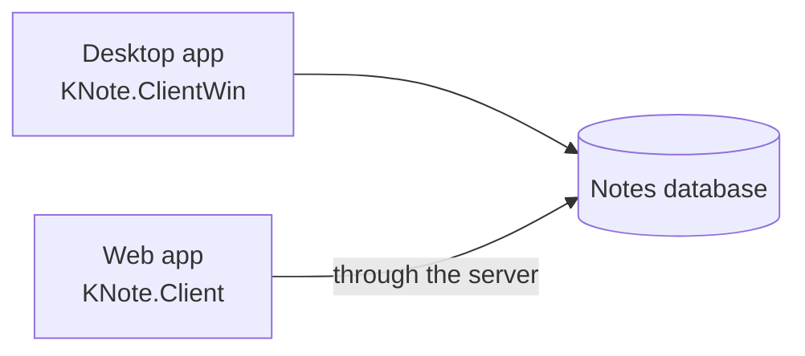

# KaNote manual

## Introduction 

KaNote is a minimalist note and task manager. Tasks or notes are stored in databases and can be organized in thematic folders. These notes can contain different resources (images, attachments, ...), link various alarms and be enriched with custom attributes. KaNote also integrates a minimalist language with which you can automate tasks. In addition to the task manager, you can give KaNote other uses, for example a small content manager.

Two different database engines are supported, Sqlite for personal tasks and SQL server for corporate use.

KaNote also has two different front-ends, an old-school Windows desktop application (WinForm app) and a Web application (Blazor app). 

TODO: ...


## User's Guide 

### Configuration files (desktop app)

The Windows desktop application keeps its configuration in the folder `%LocalAppData%\KNote`, in two XML files:

| File | What it holds | When it changes |
|---|---|---|
| `KNoteData.config` | What you configure: how you sign in, repositories (their names are kept in their databases, see *Repositories*), AI providers, e-mail (SMTP) account, alarm and auto-save options, chat room (its server and your sign-in token) and ServerCOM settings. | Only when you change a setting. |
| `KNoteState.config` | What KaNote remembers by itself: last user name you signed in with (never the password), last active folder, window positions and sizes, list layout, visible panels, the rows of the alarms panel, and the last AI provider and view options of the AI assistant. | As you use the application. |

Deleting `KNoteState.config` only resets the window layout. Deleting `KNoteData.config` makes KaNote start as if it were the first run: your databases are not deleted, but the list of repositories and AI providers is lost.

**Passwords and API keys.** The e-mail account password, the API keys of the AI providers, the sign-in token of the chat room and the password inside a repository connection string (SQL authentication) are stored encrypted with Windows data protection, tied to your Windows user and this computer. Connection strings without a password (SQLite, Windows authentication) stay readable. If you copy `KNoteData.config` to another computer or user, those secrets cannot be decrypted: KaNote tells you at startup which ones must be entered again, and everything else loads normally. A secret typed in plain text into the file by hand is accepted and gets encrypted the next time the file is saved.

**Backups.** Every time a file is saved, the previous version is kept next to it as `KNoteData.config.bak` / `KNoteState.config.bak`. If a file cannot be read, KaNote loads its `.bak` and tells you.

**Upgrading from a previous version.** Older versions kept everything in a single `KNoteData.config`. The first time this version starts, it converts that file automatically into the two files above, keeping all your values (passwords and API keys are kept, now encrypted). A copy of the old file, **without** passwords and API keys, is kept as `KNoteData.config.v1.bak`.

**Going back to an older version.** Older versions cannot read the new files and will fail at startup. To go back: close KaNote, keep a copy of the current `KNoteData.config` somewhere else, rename `KNoteData.config.v1.bak` to `KNoteData.config`, delete `KNoteState.config`, start the older version and enter your passwords and API keys again.

### Signing in, users and roles (desktop app)

**How you sign in.** By default the desktop app identifies you with your **Windows account**, without asking for anything (like the integrated security of SQL Server). In **Options → Sign in** you can choose **With a KNote user name and password** instead; the change applies the next time KaNote starts (it offers to restart). From then on, KaNote asks for a user name and password at startup, proposing the last user name used. The sign-in window also has a **Use my Windows account instead** link, which signs in with the Windows account and switches the option back.

**Each repository has its own users.** When KaNote starts, and whenever you link or create a repository, it checks your user in that repository:

| Situation | What happens |
|---|---|
| You are registered there | The repository is linked. With a KNote user name, the password must also match. |
| You are not registered there | The **Register user** window asks for your full name and e-mail (and a password). If you sign in with a KNote user name, the password is the one you signed in with, so the same credentials open all your repositories. |
| Wrong password, user disabled, or registration cancelled | The repository is not available in this session. It stays in your configuration and is tried again at the next start; KaNote tells you why once the main window opens. |

If none of your repositories accepts you, KaNote lets you try again (signing in again with a KNote user name) or close.

**Roles.** Your role is per repository, so you can be an Admin of your personal repository and a Guest in a shared one. The roles are hierarchical: each one can do everything the previous ones can, and more.

| Role | What it adds |
|---|---|
| **Guest** | Browse folders and notes, search and filter, open notes to read them, link and unlink repositories, help and about. |
| **Staff** | Create, edit and delete notes (and their tasks, resources, alarms and trace notes), PostIts, move notes and change tags, print and export to CSV, application info alarms, options, AI providers, chat and AI assistant. |
| **Project manager** | Create, edit and delete folders, KntScript console and running the code of notes, KNote assistants of the catalog. |
| **Admin** | Manage the repository (users, note types, attributes, trace note types), create repositories, COM port server and lab tools. |

The options that don't belong to one repository (options, AI, chat, scripts, creating a repository...) use your highest role among your repositories.

**Who gets which role.** The first user who registers in a repository where `adminKNote` is still the only Admin becomes an Admin too: the creator of a new repository manages it. From then on, new users register as **Guest** until an Admin raises their role in **Repository → Users**.

**Where to see it.** The status bar of the management window shows your user, your role in the active repository (it changes as you move to a folder of another repository) and your application role, e.g. `jdoe · Personal repository: Admin · Application: Admin`. Its tooltip shows how you signed in and your role in every linked repository.

**When an option isn't for your role.** All the menus stay available; choosing one your role doesn't allow just tells you which role it takes. A note opened by a Guest opens to be read: KaNote says so, and changes can't be saved. Automatic processes (reopening PostIts, alarms, script alarms) skip the repositories where your role doesn't allow them.

**Upgrading from a previous version.** The first time a database is opened with this version it is updated automatically: the role *Public* is renamed **Guest** (so users registered as *Public* can only read until an Admin raises them to Staff), the typo *ProjecManager* becomes **ProjectManager**, and the demo user `owner` is deleted if it was never used. Older versions don't know the new role names; keep a copy of a shared database before opening it with this version.

These permissions are enforced by the application. Somebody who connects to the database directly, with its connection string, is not restricted by them: protect shared databases with the database's own permissions too.

### Repositories (desktop app)

A repository is a KaNote database, SQLite or SQL Server. The **Repository** menu links an existing one, creates a new one or edits the properties of the selected one. Their **General** tab asks, in this order, for the type of database, where it is (directory and file for SQLite; server\instance and database for SQL Server), the resources container (its name, whether to save a copy of each resource in the database, its root folder and its root URL) and the repository's **Name**.

**The name is kept in the database.** The name you see in the folders tree, the status bar and the window titles is stored in the repository's own database, so everybody who opens it, in the desktop app or in the web app, sees the same name. You give it when you create the repository, and an Admin of the repository can change it in **Edit repository properties**. It can't be the name of another repository you have linked. When you link an existing repository the name isn't asked: it is the one in its database.

**One link per database.** Each database is also given an identifier of its own when it is created. A database that is already linked can't be linked again, nor can a copy of it (copying a database copies its identifier too): KaNote tells you which repository it is. If two repositories of your configuration turn out to be the same database, only the first one is opened, and KaNote tells you at startup.

**SQLite files.** KaNote opens SQLite databases in WAL mode, so that several users of the web app, or several windows, can save at the same time. Next to the database file (e.g. `knote.db`) you will see two more files while it is in use, `knote.db-wal` and `knote.db-shm`: they belong to the database, don't delete them. To copy the database (a backup, another computer), close KaNote and the web server first, so that everything is in the `.db` file. Keep SQLite databases on a disk of the computer that uses them, not in a network folder.

**Upgrading from a previous version.** Earlier versions kept the repository's name (its *alias*) in `KNoteData.config`. The first time this version opens a repository, its database takes that alias as its name (or, if there is none, the name of the database: the SQLite file or the SQL Server database), and the alias is removed from the file. A repository that can't be opened keeps its alias until it can. If another user already opened a shared database with this version, you see the name that user's alias gave it; an Admin can rename it.

### Notes list (desktop app)

**Refreshing the list.** **Edit → Refresh notes list** (`Ctrl+R`) reads the notes of the selected folder, search or filter again from the database and sorts them again. Use it after changing the field the list is ordered by (the priority, for instance): an edited note is updated in the list, but it isn't moved to its new place until the list is refreshed. The selected note stays selected.

**All the notes of a repository.** Clicking a repository's node in the folders tree (the one with its name in brackets) lists all of its notes. As that can take a long time in a large database, KaNote asks first: **Cancel** leaves the notes list and the note viewer empty. Refreshing the list you have already loaded doesn't ask again.

**Safe notes.** A note's description can carry HTML (written in the HTML editor or in Markdown). To protect whoever reads it, KaNote shows it without what could run code on its own (scripts, `javascript:` links, forms...), both in the desktop app and in the web app; the formatting (fonts, colors, tables, images, links) is kept.

### Diagrams in notes

A note written in Markdown can include diagrams (flowcharts, sequence, class or state diagrams, Gantt charts, pie charts...) described as text with [Mermaid](https://mermaid.js.org/): write the description in a code block whose language is `mermaid`. For example:

````markdown

````

Both apps draw it wherever the note is shown as it looks: in the desktop app, the note's view, its tasks and the post-it; in the web app, Home, the note view and the **Preview** of the description and of the tasks.

- In a label, `<br/>` starts a new line.
- If the description has an error, the block is shown as text, so you can see it and fix it.
- Diagrams follow the light or dark mode (in the web app they change with the theme). A note with colors of its own, shown on a white sheet in the dark themes of the web app, keeps its diagrams light.
- They are not drawn in the desktop app's HTML editor and Markdown view (they are text there), in prints and PDFs, or in the answers of the AI assistant and the messages of the chat room.
- No Internet connection is needed: Mermaid comes with KaNote. A note with diagrams takes a little longer to show (about half a second); the others are not affected.
- They are safe to show: Mermaid draws them with its strict security level and, in the desktop app, the page of a note with diagrams can run only KaNote's own scripts (a Content Security Policy).

### Printing and exporting (desktop app)

The **File** menu of the management window has these options (the three prints grouped in its **Print** submenu), all working on the notes list exactly as you see it: the notes of the selected folder, or the result of a search or a filter, in the order and with the columns shown on screen (including the compact view and the list filter).

| Option | Result |
|---|---|
| **Print > Notes list ...** | The list as a table, in landscape, headed by the folder path or a summary of the search/filter. All the visible columns fit the page width. The **Print** button of the toolbar does the same. |
| **Print > Notes list as book ...** | A book: a cover, a table of contents with page numbers and one chapter per note, in the order of the list. The chapter title is the note's topic and its text the note's description. A book of more than 100 notes can take a long time to generate, so KaNote asks first. |
| **Print > Selected note details ...** | Everything about the selected note, as saved: properties, description, attributes, resources (with a thumbnail of the images), tasks and trace notes. The note's script and its alarms are not printed. |
| **Export notes list to CSV ...** | The same content as the printed list, as a CSV file. |

The note editor has its own **Print** button, which prints the details of the note being edited as you are seeing it. If it has changes not saved yet, the report says so.

**Preview, printer and PDF.** Every print opens a preview window first. From it, **Print ...** opens the print dialog (choose the printer, or *Save as PDF*, which also has its own page preview) and **Save as PDF ...** saves the report directly as a PDF file. The book takes a moment longer to open: it is paginated once to know the page numbers of its table of contents.

**CSV files.** The proposed file name describes the folder, search or filter of the list. The file uses the list separator of your regional settings (`;` in Spanish, for instance) and UTF-8 encoding, so Excel opens it directly with a double click. A text that starts with `=`, `+`, `-` or `@` (e.g. a topic like `- Quick links`) is written with a leading apostrophe, so that spreadsheets show it as text instead of trying to run it as a formula.

The save dialogs (PDF and CSV) start in the folder where you last saved one of them.

### KntScript console (desktop app)

**Tools → KntScript console** (Project manager role or higher) opens an editor for code on the left and its output on the right. The toolbar has:

| Button | What it does |
|---|---|
| **New**, **Open**, **Save** | Start empty code, open a code file (`.knts`, `.cs`, `.py`, `.js`, or `.txt` for a natural-language prompt) or save it. Opening a file selects its language from its extension. |
| **Insert code snippet ...** | Inserts at the cursor a code snippet of the catalog (the notes of type `@Code` of the Assistant repository, or of the active folder's repository if there isn't one), the same catalog as the note editor's **Insert code snippet ...**. It also selects the snippet's language. |
| **Language** | The language of the code: KntScript, C#, Python, JavaScript or Natural language. |
| **Run** | **Run in integrated output console** (`F5`) shows the output in the console itself, where you can also type the input the program asks for. **Run in standard output (stdout)** (`Shift+F5`) runs it in a separate system console window; it is only available for C#, Python and JavaScript. A natural-language prompt is sent to the AI assistant, which answers in its own window. |

If the code has changes that haven't been saved, **New**, **Open** and closing the window ask before discarding them.

### AI assistant (desktop app)

The AI assistant window shows the whole conversation in its upper area. Write a question below and click **Send**. The list next to **New session** chooses the AI model that answers. On the right, the **Sessions** panel lists your previous conversations (see *AI assistant sessions* below).

The assistant can also work with your notes: ask it to look for notes about something, to tell you what a note says, or to note down a task, and it uses the notes of the repository you are working in. A task it creates is saved in your default folder and opened in the note editor, where you can change it, keep it or delete it. The assistant's own sessions and the chat room threads are left out when it searches your notes.

The conversation can be seen in two ways, chosen with the buttons above it:

| Button | View |
|---|---|
| **Navigate** | As a chat (the default): your questions on the right, in a bubble, and each answer below with its text formatted (headings, lists, tables, code) and, at its foot, the tokens and the time it took. Links of an answer open in your web browser. |
| **Markdown** | The text of the conversation exactly as it is saved in its session note. Each question and answer is preceded by a hidden marker (`<!-- knt-ai:user -->`, `<!-- knt-ai:assistant {...} -->`) that note viewers don't show; the marker of an answer holds its tokens and time. |

The **Actions** menu repeats what the buttons and the list do: **Send** (`Ctrl+Enter`), **New session**, **Model** (the same models as the list), **Navigate view** and **Markdown view**. Its options are available exactly when their button is.

The **Options** menu has the rest:

| Option | What it does |
|---|---|
| **Get stream** / **Get completion** | How answers arrive: as they are being written (the default) or all at once when they are complete. |
| **Get prompt from catalog ...** (`Ctrl+K`) | Starts a new conversation from a prompt of the catalog. |
| **View system root ...** | Shows the instructions the model receives before the conversation. |
| **Show model info (tokens, time)** | Shows or hides, below each answer of the chat view, the tokens and the time it took. The Markdown view always has them, in the marker of each answer. |
| **Manage models ...** | Adds, changes or removes the AI models (providers) you can choose. |

Sending a question keeps the view you are in. KaNote remembers the view and the **Show model info** option for the next time you open the assistant. The assistant opened from the menu also remembers its window's position and size, the width of the **Sessions** panel and the height of the question box. The tokens are the ones reported by the AI provider; when a provider doesn't report them, they are estimated (the chat says so). If an answer fails halfway, what arrived of it is marked as failed and is not part of the conversation: it disappears when you send the next question. If an answer reaches the maximum length a model can write in one answer, the chat view ends it with a notice saying it was cut (shown even with **Show model info** off): ask the assistant to continue. **New session**, changing the AI provider or choosing a prompt of the catalog start a new, empty conversation; the current one is already saved.

### AI assistant sessions

Every conversation with the AI assistant is kept as a **session**, so you can come back to it later, in the desktop app or in the web app: both use the same sessions.

**Where they are kept.** Each session is a note of the repository you are working in, of the note type **`@ChatSessions`**, in the folder **AI Assistant sessions**. The note's topic is the first line of your first question, its description is the conversation (as the Markdown view shows it), its attributes **AiProvider** and **AiModel** say which AI model answered, and a task assigned to you, starting when the session began, links it to you. The note type, its two attributes and the folder are created the first time you open the assistant in a repository that doesn't have them.

**When they are saved.** After every answer. If saving fails, KaNote tries again before you leave the conversation (a new session, another session, another provider, closing the window) and, if it still can't, asks you whether to discard its last messages.

**Going back to a session.** The **Sessions** panel lists your sessions, the most recent first; choose one to see it again and go on with it. It continues with the AI model it was held with; if that model is no longer configured, it continues with your default one and KaNote tells you so. The panel only lists your own sessions, and only you can open or continue them from the assistant.

**Privacy.** Sessions are ordinary notes: anybody who can browse the **AI Assistant sessions** folder of a shared repository can open them as any other note. Don't write in a conversation anything you wouldn't write in a note of that repository.

**Desktop app.** Sessions are kept only when you open the assistant from the menu. When a KntScript script or a note's natural-language code (`ln`) uses the assistant, nothing is saved (a script can turn it on with `PersistSession = true`). The **Sessions** panel is hidden then.

### Chat room

The chat room lets the users of a KaNote web server talk in **threads**: each thread is a conversation about one topic, and every user with the Staff role or a higher one in that server can read it, join it and write in it. The web app and the desktop app share the same chat room, the one of the web server: a message written in one appears at once in the other.

**Where threads are kept.** Each thread is a note of the web server's repository, of the note type **`@KNoteChatRoom`**, in the folder **KNote Chat Room**; the note type and the folder are created the first time the chat room is used. The note's topic is the thread's topic and its description is the conversation, in Markdown, with a hidden marker before each message (`<!-- knt-chat:message {...} -->`) that holds who wrote it and when. Whoever creates a thread, writes in it or sends an image to it gets a task in its note that links them to it: they are its participants. Each message is saved as soon as it is sent.

**Following threads.** While you are connected you *follow* the threads you take part in and the ones you open: their new messages arrive at once, and the ones of a thread you aren't looking at are counted as new in the threads list (the thread is shown in bold). The new messages of the threads you don't follow are counted too. **Stop following** stops receiving the messages of the thread shown until you open it again. The header of a thread shows who is in it now.

**Messages.** They are written in Markdown (bold, lists, code, links...): **Enter** sends the message and **Shift+Enter** starts a new line. For your safety, any HTML that a message contains is shown as text. Links open in your web browser.

**Images.** Paste an image into the message box or drop it (png, jpg, gif or webp, up to 5 MB) and it is sent to the thread shown. Each image is kept as a resource of the thread's note, in the resources folder of the web server (the same as the images of the notes, so the server needs its resources settings: `ResourcesContainer` and their folder and url), and is sent as a message. Click an image to see it at its size.

**The General thread.** A KntScript script that sends a message (`SendChatMessage`, or `SendMessage` of the chat controller) with no thread shown writes in the thread **General**, which is created when it doesn't exist.

**Privacy.** Threads are ordinary notes: anybody who can browse the **KNote Chat Room** folder of the server's repository can open them, and their images are served as files of the server, like the images of the notes. The chat room threads are left out when the AI assistant searches your notes.

### Chat room (desktop app)

**Signing in to the chat room's server.** The desktop app works with its own repositories, so it signs in once to the web server of the chat room: in **Options**, tab **Chat room**, enter the **chat hub url** (the address of the web server ending in `/chathub`, e.g. `https://server/KNote/chathub`), your **user name** and **password** in that server, and click **Sign in**. KaNote checks them and connects to test them; then it keeps only the sign-in token the server gives (encrypted, like the other secrets of `KNoteData.config`) and forgets the password. **Accept** the options to keep it. The token lasts a year: if the server refuses it (it expired, your role there changed...), sign in again. **Sign out** forgets it, and so does changing the url.

**The window.** **Chat room ...** in the menu opens it. When the app starts, it connects in the background with the window hidden, and shows the window when somebody else writes in a thread you follow; closing the window only hides it. On the left, the conversation of the thread shown and, below it, the message box; on the right, the **Threads** list (**New**: the messages that arrived since you last saw it; **Activity**: its last message). **New thread** asks for its topic; **Stop following**, above the conversation, also shows who is in the thread now; **Image ...** chooses an image to send. The status bar shows the connection, your user and the server. The **Actions** menu repeats them: **Send** (`Ctrl+Enter`), **Send image ...**, **New thread ...**, **Stop following the thread** and **Reconnect**. KaNote remembers the window's position and size, the width of the threads panel and the height of the message box.

**Images.** `Ctrl+V` in the message box sends the image of the clipboard (a screenshot, for example) or the image files copied in the file explorer; image files can also be dropped on the message box, or chosen with **Image ...**.

If the connection fails when the app starts, KaNote tells you without interrupting and stops connecting at startup until you sign in again from **Options**.

### Chat room (web app)

**Chat room** in the side menu (Staff role or higher) opens the chat room page: the conversation of the thread shown on the left, with its participants and who is online now, and the **Threads** list on the right, with the new messages of each one. Drag the bar between them to resize them (the browser remembers it). The header shows the connection's state, **Stop following**, **New thread** and the button that opens the chat room in a new window.

The web app connects to the chat room when you sign in and leaves it when you sign out, so while it is open you are told about the new messages of the threads you follow, even on other pages. Images are pasted into the message box or dropped on the conversation; clicking one opens it in a new tab.

**In its own window.** The button that opens it in a new window moves the chat room, with the thread shown, to a window of its own, without the app's menus, so you can keep it next to your work; the main window goes back to Home. There is only one chat room window: opening it again brings it to the front. The main window keeps following your threads, so it still tells you about their new messages. If the browser blocks the window, allow pop-ups for the app's site.

### Home (web app)

Home is the first page of the web app, and it can be seen without signing in. Its header shows the repository's name, the same one as in the desktop app; on the other pages the top bar shows it after *KNote* (on a phone there is only room for *KNote*).

Home shows the notes of the repository's **Home** folder, by priority and topic, 25 at most. When Home has folders inside, a panel at the right of the notes lists them after **Home**: choose one to see its notes, with the same order. Home remembers your choice while the app is open. On a phone the panel is a row above the notes.

Only the folders directly inside Home are listed there, and anybody can open them and their notes without signing in, like Home itself: keep there only what can be public.

The web server names a new database with the `Name` setting of its `RepositoryRef` section (in `appsettings.json` or its secrets); the old `Alias` setting is still read.

### Notes lists (web app)

The **Tree panel**, **Notes filter** and **Quick search** pages show their notes in the same list, with the columns of the desktop app's notes list. It fills the window and loads more notes as you scroll; the total is shown above it. The **View options** menu of the page header groups the ways of looking at the notes: **View note**, **Show preview** / **Hide preview** and **Extended list** / **Compact list**. **Extended list** / **Compact list** switches between all the columns and the compact view (number, topic, priority and tags), which is the default; the choice applies to the three pages and the browser remembers it. The topic column keeps a minimum width: in a narrow window the list scrolls sideways. In the tree panel, the folders tree has its own scroll.

**Selecting and opening.** A click (also a right click) selects a note, which is highlighted; a double click or **Enter** edits it (users who can't edit view it). The arrows, **Page Up**, **Page Down**, **Home** and **End** move the selection. Coming back to the page (e.g. from the side menu), the list is where you left it, with the same note selected.

**Actions.** The **Edit note** and **Delete note** buttons of the page header, and **View note** in its **View options** menu, act on the selected note. A right click on a note, the context menu key or **Shift+F10** show its actions (**View**, **Edit**, **Delete**), and **Delete** deletes the selected note after confirming it. Editing and deleting need the Staff role or a higher one. The notes of **Home** show their actions in a **⋮** menu.

**Preview.** **Show preview** / **Hide preview**, in the **View options** menu, shows, at the right of the list, the note that is selected; it changes as you select another one, and shows the note's changes when it is saved in its window. The pane can be resized with the bar between it and the list. The choice applies to the three pages and the browser remembers it, as well as the sizes you give to the panes of each page.

**Note windows.** Viewing, editing or creating a note (**New note**) opens it in a window of its own, without the app's menus, so you can keep it next to the list; new windows open in cascade from the main one. Each note has one view window and one edit window: opening it again brings that window to the front. Each **New note** opens a new window, in the folder selected in the tree panel; once saved, it is that note's edit window. When a note is saved in its edit window, the lists, Home and the note's view window show it changed. The exit button of the edit window closes it, asking first if there are unsaved changes (as does closing the window). If the browser blocks the window, allow pop-ups for the app's site. The chat room and the AI assistant can also be opened in a window of their own (see their sections).

**Admin panel.** The lists of users, note types, trace note types and attributes work the same way: a click selects a row, the **Edit** and **Delete** buttons of the header act on it, a right click shows the same actions and a double click edits the item. Those lists sort by clicking their headers and scroll on their own. In **Folders management**, the header buttons edit or delete the selected folder; a right click on a folder shows the same actions and a double click edits it.

**Sorting.** Clicking a column header sorts the list by that column; a second click reverses the order and a third one goes back to the list's own order. In the tree panel each folder opens in its notes order, as in the desktop app: by note number, a fixed order, or, when the folder follows the last order used, the last one chosen in either app (sorting the folder's notes saves it). The notes order of a folder is set in its edit form (**Folders**), with the same options as in the desktop app.

**Coming back to the list.** After opening a note, the list is shown again as it was: the same folder, filter or search, the same order and position, with a mark on the left of the note you opened.

### Printing and exporting (web app)

The **Print/Export** menu of the **Tree panel**, **Notes filter** and **Quick search** pages has the same reports as the desktop app. They work on the whole list of the page (all its notes, not only the ones loaded on screen), in the order and with the columns it shows (compact or extended view). They need the Staff role or a higher one.

| Option | Result |
|---|---|
| **Print list ...** | The list as a table, in landscape, headed by the folder path or a summary of the search/filter. |
| **Print as book ...** | A book: a cover, a table of contents and one chapter per note, in the order of the list. The chapter title is the note's topic and its text the note's description. The table of contents links to the chapters but has no page numbers: the browser can't know them before printing. A book of more than 100 notes can take a long time to generate, so KaNote asks first. |
| **Print note details ...** | Everything about the selected note, as saved: properties, description, attributes, resources (with a thumbnail of the images), tasks and trace notes. Available when a note is selected. |
| **Export to CSV ...** | The same content as the printed list, as a CSV file that the browser downloads. |

**Preview, printer and PDF.** Every print opens a preview in the app, which shows the report as soon as it is generated; closing it before cancels it (useful with a large book). **Print ...** opens the browser's print dialog for the report only: choose the printer, or *Save as PDF*. The running header and the page numbers are drawn by Edge and Chrome; other browsers may leave them out. The links of a report open in a new tab.

**Language and CSV files.** Dates and numbers are written as your browser's language writes them, and the CSV file uses its list separator (`;` in Spanish, for instance) and UTF-8 encoding, so Excel opens it directly. As in the desktop app, the proposed file name describes the folder, search or filter of the list, and a text that starts with `=`, `+`, `-` or `@` is written with a leading apostrophe.

### Note editor (web app)

A note is edited in its own window. Its header shows the note's topic and number, the full path of its folder, its type and when it was modified, with **Save and new**, **Save** and the button that closes the window (it asks first if there are unsaved changes).

- **Overview**: the topic and the description and, at the right, the note's details (folder, type, priority, tags) and its record (number, dates, status). The description is written in Markdown, with a toolbar for its formats (headings, bold, lists, tasks, links, images, tables...): each tool works on the selected text or lines, and clicking it again removes the format. `Ctrl+B`, `Ctrl+I` and `Ctrl+K` make bold, italics and a link; **Link** and **Image** write the link with its address selected, ready to type it (if the selection is an address, its text is selected instead). `Ctrl+Z` and **Undo** undo the tools too. Typing is as fast with a long note as with a short one. **Preview** shows it as it looks. The browser remembers which of the two you use.
- **Locked content**: the **Content** switch of the record locks the note's description: it is shown, not edited, until it is unlocked. The lock is saved with the note, and it is the same one the desktop app sets.
- **Attributes**: the fields of the note's type and the general ones; the required ones are marked with an asterisk.
- **Resources**: the note's files as cards. Click a resource to see it in the note's window, without leaving it: images (click the image to see it at its size), PDF, video, audio and text files; the other files open in a new tab of the main window. Any file can be edited (its description and its order, not the file itself), opened in a new tab, inserted in the description (where its cursor was, in a paragraph of its own; at the end if it wasn't used) or deleted. **Add resource** uploads a file: drop it on the box, paste it or click to choose it.
- **Tasks**: as in the desktop app, the list of tasks (by priority) and, beside it, the task selected: who it is for, its priority, dates and times, and its description shown as it looks (it may be long, with images). Drag the bar between them to resize them (the browser remembers it); in a narrow window the task goes below the list. A resolved task is marked as such, and its text reads as the others. **Add task**, **Edit** or a double click open the task: its topic, its user, its description (Markdown, with **Preview**), its planning and its progress. A new task is yours, after the others and started now; resolving a task without an end date sets it to now.

- **Trace notes**: as in the desktop app, the relations of the note with other notes, in two lists: **Trace notes from** (other notes that lead to this one) and **Trace notes to** (other notes this one leads to). Each relation shows the other note (number, topic and tags), its type, its order and its weight. **Add** opens the relation: the other note, chosen with **Select** (a text search, or browsing the folders tree; the note itself can't be chosen), its **Type** (optional; the types are managed in the admin panel), **Order** and **Weight**; the dialog shows the direction of the relation. The same two notes can be traced only once in the same direction with the same type (with no type too). A relation is saved at once, without saving the note. **Edit**, the button that removes it (it asks first; the other note is not deleted) and the one that opens the other note in its own window are on each row; a double click also opens it.

A new note has to be saved before adding resources, tasks or trace notes to it, and deleting a resource or a task asks first. The dialogs of the admin panel (users, folders, note types, trace note types, attributes) and the sign in and register ones follow the same style: labels above the fields, grouped in sections.

### Appearance (web app)

The palette button in the top bar of the web app opens the **Appearance** panel, where you choose the **theme** (Software, Standard, Material, Humanistic or Default), the **mode** (light or dark), the style of the **Home header** (*Soft*, a light tint of the theme's color, or *Ink*, dark) and **high contrast (WCAG)**, which makes text and borders easier to tell apart. Changes apply at once. The sun / moon button next to it switches between light and dark directly. Your browser remembers the choice (in cookies), so each browser keeps its own.

### AI Assistant (web app)

**AI Assistant** in the side menu (Staff role or higher) opens the web version of the assistant. Its header shows the list of AI models (configured in the server, see below), the **New conversation** button and the one that opens the assistant in a new window; the **Sessions** panel on the right lists your sessions, as in the desktop app (see *AI assistant sessions*), and the session you are in shows the tokens of its conversation. Drag the bar between the conversation and the question box to make the box taller or shorter.

Write a question in the box at the bottom and click the send button (or press `Ctrl+Enter`). The answer appears as it is written; while it arrives you can stop it with the stop button, and then the question goes back to the box. An answer that fails or that you stop is not part of the conversation and is not saved.

The assistant can search your notes and create tasks, as in the desktop app. A note it creates is saved in the repository's home folder: KaNote tells you, and the chat shows a link that opens it in its edit window.

Changing the AI model of a conversation that has already started begins a new conversation (KaNote asks first). For your safety, any HTML that an answer contains is shown as text, never as part of the page.

**In its own window.** The button that opens it in a new window moves the assistant, with the session you are in, to a window of its own, without the app's menus; the main window goes back to Home. It can't be used while an answer is arriving. There is only one assistant window: opening it again brings it to the front. Closing that window while an answer is arriving, or when the conversation could not be saved, asks first.

### AI providers of the web app (server configuration)

The AI models offered by the web app are configured in the server, in the `ai` section of `appsettings.json`, with the same fields as the AI providers of the desktop app:

```json
"ai": {
  "providers": [
    { "alias": "OpenAI gpt-4o-mini", "provider": "OpenAI", "model": "gpt-4o-mini", "apiKey": "" },
    { "alias": "Anthropic Claude Haiku 4.5", "provider": "Anthropic", "model": "claude-haiku-4-5", "apiKey": "" },
    { "alias": "Ollama llama3.1", "provider": "Ollama", "model": "llama3.1", "host": "http://localhost:11434" }
  ]
}
```

| Field | Meaning |
|---|---|
| `alias` | The name shown in the list. |
| `provider` | `OpenAI`, `Anthropic` or `Ollama`. |
| `model` | The model of that provider. |
| `apiKey` | The API key (OpenAI and Anthropic). Leave it empty in `appsettings.json`: see below. |
| `host` | The address of the Ollama server (Ollama only). |

The first valid provider is the default one. A provider whose configuration is not valid is left out (the server log says why).

**API keys.** Never write them in `appsettings.json`. In development, keep them in the server's user secrets, by the position of the provider in the list (`ai:providers:0:apiKey`, `ai:providers:1:apiKey`...):

```powershell
dotnet user-secrets set "ai:providers:0:apiKey" "sk-..." --project Server/KNote.Server.csproj
```

In a server, use environment variables (`ai__providers__0__apiKey`) or your hosting's secret store. If a key is empty, the server uses the `OPENAI_API_KEY` or `ANTHROPIC_API_KEY` environment variable. The keys never reach the browser: the web app only receives the alias, provider and model of each one.

TODO: ...