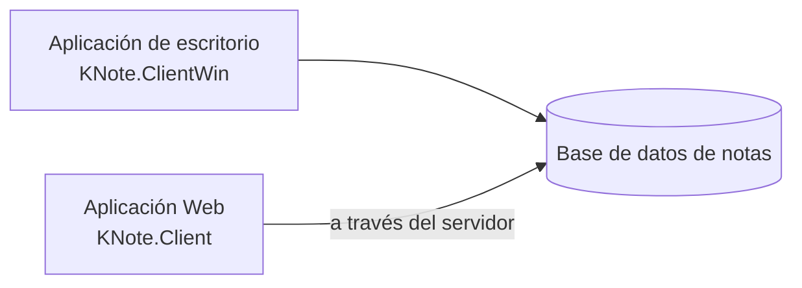

# Manual KaNote

## Introducción

KaNote es un gestor de notas y tareas minimalista. Las tareas o notas se almacenan en bases de datos y se pueden organizar en carpetas temáticas. Estas notas pueden contener diferentes recursos (imágenes, archivos adjuntos, ...), vincular diversas alarmas y enriquecerse con atributos personalizados. KaNote integra también un lenguaje minimalista con el que puedes automatizar tareas. Además de gestor de tareas puedes darle otros usos a KaNote, por ejemplo un pequeño gestor de contenido. 

Se soportan dos motores diferentes de bases de datos, Sqlite para tareas personales y SQL server para uso corporativo. 

KaNote tiene también dos front-end diferentes, una aplicación windows de escritorio a la vieja escuela (WinForm app) y un aplicativo Web (Blazor app).

TODO: ...


## Guía de usuario

### Ficheros de configuración (aplicación de escritorio)

La aplicación de escritorio de Windows guarda su configuración en la carpeta `%LocalAppData%\KNote`, en dos ficheros XML:

| Fichero | Qué contiene | Cuándo cambia |
|---|---|---|
| `KNoteData.config` | Lo que tú configuras: cómo entras, repositorios (sus nombres se guardan en sus bases de datos, ver *Repositorios*), proveedores de IA, cuenta de correo (SMTP), opciones de alarmas y autoguardado, chat room (su servidor y tu token de acceso) y ajustes de ServerCOM. | Solo cuando cambias un ajuste. |
| `KNoteState.config` | Lo que KaNote recuerda por sí mismo: último usuario con el que entraste (nunca la contraseña), última carpeta activa, posición y tamaño de las ventanas, disposición de las listas, paneles visibles, las filas del panel de alarmas, y el último proveedor de IA y las opciones de vista del asistente de IA. | Mientras usas la aplicación. |

Borrar `KNoteState.config` solo restablece la disposición de las ventanas. Borrar `KNoteData.config` hace que KaNote arranque como si fuera la primera vez: tus bases de datos no se borran, pero se pierde la lista de repositorios y de proveedores de IA.

**Contraseñas y API keys.** La contraseña de la cuenta de correo, las API keys de los proveedores de IA, el token de acceso del chat room y la contraseña incluida en la cadena de conexión de un repositorio (autenticación SQL) se guardan cifradas con la protección de datos de Windows, ligadas a tu usuario de Windows y a este equipo. Las cadenas de conexión sin contraseña (SQLite, autenticación de Windows) siguen siendo legibles. Si copias `KNoteData.config` a otro equipo o usuario, esos secretos no se pueden descifrar: KaNote te indica al arrancar cuáles debes volver a introducir, y el resto se carga con normalidad. Un secreto escrito en texto plano a mano en el fichero se acepta y se cifra la siguiente vez que se guarde.

**Copias de seguridad.** Cada vez que se guarda un fichero, la versión anterior se conserva a su lado como `KNoteData.config.bak` / `KNoteState.config.bak`. Si un fichero no se puede leer, KaNote carga su `.bak` y te avisa.

**Actualización desde una versión anterior.** Las versiones anteriores guardaban todo en un único `KNoteData.config`. La primera vez que arranca esta versión, convierte ese fichero automáticamente en los dos anteriores, conservando todos tus valores (las contraseñas y API keys se conservan, ahora cifradas). Se guarda una copia del fichero antiguo, **sin** contraseñas ni API keys, como `KNoteData.config.v1.bak`.

**Volver a una versión anterior.** Las versiones anteriores no pueden leer los ficheros nuevos y fallarán al arrancar. Para volver: cierra KaNote, guarda en otro sitio una copia del `KNoteData.config` actual, renombra `KNoteData.config.v1.bak` a `KNoteData.config`, borra `KNoteState.config`, arranca la versión anterior y vuelve a introducir tus contraseñas y API keys.

### Acceso, usuarios y roles (aplicación de escritorio)

**Cómo entras.** Por defecto la aplicación de escritorio te identifica con tu **cuenta de Windows**, sin pedirte nada (como la seguridad integrada de SQL Server). En **Options → Sign in** puedes elegir en su lugar **With a KNote user name and password**; el cambio se aplica la próxima vez que arranque KaNote (te ofrece reiniciar). A partir de entonces, KaNote pide un usuario y una contraseña al arrancar, proponiendo el último usuario usado. La ventana de acceso tiene también un enlace **Use my Windows account instead**, que entra con la cuenta de Windows y vuelve a dejar la opción como estaba.

**Cada repositorio tiene sus propios usuarios.** Al arrancar KaNote, y siempre que vinculas o creas un repositorio, se comprueba tu usuario en ese repositorio:

| Situación | Qué pasa |
|---|---|
| Estás registrado en él | El repositorio se vincula. Con un usuario de KNote, la contraseña también tiene que coincidir. |
| No estás registrado en él | La ventana **Register user** te pide el nombre completo y el correo (y una contraseña). Si entras con un usuario de KNote, la contraseña es la del acceso, para que las mismas credenciales abran todos tus repositorios. |
| Contraseña incorrecta, usuario deshabilitado o registro cancelado | El repositorio no está disponible en esta sesión. Se mantiene en tu configuración y se vuelve a intentar en el siguiente arranque; KaNote te dice el motivo al abrirse la ventana principal. |

Si ninguno de tus repositorios te acepta, KaNote te deja reintentar (volviendo a pedir el usuario, si entras con uno de KNote) o cerrar.

**Roles.** Tu rol es por repositorio, así que puedes ser Admin de tu repositorio personal y Guest en uno compartido. Los roles son jerárquicos: cada uno puede hacer todo lo de los anteriores, y algo más.

| Rol | Qué añade |
|---|---|
| **Guest** | Navegar por carpetas y notas, buscar y filtrar, abrir notas para leerlas, vincular y desvincular repositorios, ayuda y "acerca de". |
| **Staff** | Crear, editar y borrar notas (y sus tareas, recursos, alarmas y notas trazadas), post-its, mover notas y cambiar etiquetas, imprimir y exportar a CSV, alarmas de información de la aplicación, opciones, proveedores de IA, chat y asistente de IA. |
| **Project manager** | Crear, editar y borrar carpetas, consola de KntScript y ejecutar el código de las notas, asistentes de KNote del catálogo. |
| **Admin** | Administrar el repositorio (usuarios, tipos de nota, atributos, tipos de traza), crear repositorios, servidor de puerto COM y herramientas del laboratorio. |

Las opciones que no pertenecen a un repositorio (opciones, IA, chat, scripts, crear un repositorio...) usan tu rol más alto entre tus repositorios.

**Quién recibe qué rol.** El primer usuario que se registra en un repositorio donde `adminKNote` sigue siendo el único Admin pasa a ser Admin también: quien crea un repositorio nuevo lo administra. A partir de ahí, los usuarios nuevos se registran como **Guest** hasta que un Admin les sube el rol en **Repository → Users**.

**Dónde se ve.** La barra de estado de la ventana de gestión muestra tu usuario, tu rol en el repositorio activo (cambia al pasar a una carpeta de otro repositorio) y tu rol de aplicación, p. ej. `jdoe · Personal repository: Admin · Application: Admin`. Su tooltip, encima de la barra de estado, muestra cómo has entrado y tu rol en cada repositorio vinculado; un doble clic abre **My profile**.

**Tu perfil y tu contraseña.** **Tools → User** tiene dos opciones, para cualquier rol:

- **My profile ...**: tu nombre completo y tu correo, tal como están en el repositorio activo. Solo un Admin puede cambiar tu nombre de usuario. Cambiar el correo pide tu contraseña actual. **Save it in every linked repository** (marcada por defecto; aparece cuando hay más de uno) los guarda en todos tus repositorios.
- **Change password ...**: tu contraseña actual y la nueva, dos veces. Cambia en todos los repositorios vinculados, porque cada uno guarda tu usuario (si entras con un usuario de KNote, la misma contraseña tiene que abrirlos todos). Si un repositorio la rechaza (otra contraseña allí, un usuario deshabilitado...), los demás cambian igualmente y KaNote te dice cuál; si entras con un usuario de KNote, ese repositorio no se abrirá en tu próxima sesión hasta que tenga la misma contraseña.

Una contraseña nueva tiene al menos 8 caracteres y no puede ser tu nombre de usuario, también al registrarte o cuando la pone un Admin; las contraseñas puestas antes siguen valiendo.

**¿Olvidaste tu contraseña?** El enlace **Forgot your password?** de la ventana de acceso explica quién puede ponerte una nueva, ya que tu usuario está en cada repositorio y la aplicación de escritorio no tiene un correo desde el que enviar un enlace: un Admin de cada repositorio (**File → Repositories → Edit repository properties → Users**, editar el usuario, **Reset password**); el **Forgot your password?** de la aplicación Web, si el repositorio también lo usa la Web; o tu cuenta de Windows, si tus repositorios tienen ese usuario.

**Cuando una opción no es para tu rol.** Todos los menús siguen disponibles; elegir uno que tu rol no permite solo te indica qué rol hace falta. Una nota abierta por un Guest se abre para leerla: KaNote lo avisa y los cambios no se pueden guardar. Los procesos automáticos (reabrir post-its, alarmas, alarmas de script) se saltan los repositorios donde tu rol no los permite.

**Actualización desde una versión anterior.** La primera vez que se abre una base de datos con esta versión se actualiza automáticamente: el rol *Public* pasa a llamarse **Guest** (así que los usuarios registrados como *Public* solo pueden leer hasta que un Admin los sube a Staff), la errata *ProjecManager* pasa a **ProjectManager** y el usuario de ejemplo `owner` se borra si nunca se usó. Las versiones anteriores no conocen los nombres nuevos de los roles; guarda una copia de una base de datos compartida antes de abrirla con esta versión.

Estos permisos los aplica la aplicación. Quien se conecte a la base de datos directamente, con su cadena de conexión, no queda limitado por ellos: protege también las bases de datos compartidas con los permisos de la propia base de datos.

### Repositorios (aplicación de escritorio)

Un repositorio es una base de datos de KaNote, SQLite o SQL Server. El menú **Repository** vincula uno existente, crea uno nuevo o edita las propiedades del seleccionado. Su pestaña **General** pide, en este orden, el tipo de base de datos, dónde está (directorio y fichero en SQLite; servidor\instancia y base de datos en SQL Server), el contenedor de recursos (su nombre, si se guarda una copia de cada recurso en la base de datos, su carpeta raíz y su URL raíz) y el **Name** (nombre) del repositorio.

**El nombre se guarda en la base de datos.** El nombre que ves en el árbol de carpetas, la barra de estado y los títulos de las ventanas se guarda en la propia base de datos del repositorio, así que todo el que la abre, en la aplicación de escritorio o en la Web, ve el mismo nombre. Lo das al crear el repositorio, y un Admin del repositorio puede cambiarlo en **Edit repository properties**. No puede ser el nombre de otro repositorio que tengas vinculado. Al vincular un repositorio existente no se pide el nombre: es el de su base de datos.

**Un vínculo por base de datos.** Cada base de datos recibe además un identificador propio al crearse. Una base de datos ya vinculada no se puede volver a vincular, ni tampoco una copia suya (copiar una base de datos copia también su identificador): KaNote te dice qué repositorio es. Si dos repositorios de tu configuración resultan ser la misma base de datos, solo se abre el primero, y KaNote te avisa al arrancar.

**Ficheros SQLite.** KaNote abre las bases de datos SQLite en modo WAL, para que varios usuarios de la aplicación Web, o varias ventanas, puedan guardar a la vez. Junto al fichero de la base de datos (p. ej. `knote.db`) verás otros dos mientras está en uso, `knote.db-wal` y `knote.db-shm`: son parte de la base de datos, no los borres. Para copiar la base de datos (una copia de seguridad, otro equipo), cierra antes KaNote y el servidor Web, así todo queda en el fichero `.db`. Guarda las bases de datos SQLite en un disco del equipo que las usa, no en una carpeta de red.

**Actualización desde una versión anterior.** Las versiones anteriores guardaban el nombre del repositorio (su *alias*) en `KNoteData.config`. La primera vez que esta versión abre un repositorio, su base de datos toma ese alias como nombre (o, si no lo hay, el nombre de la base de datos: el fichero SQLite o la base de datos de SQL Server), y el alias se quita del fichero. Un repositorio que no se puede abrir conserva su alias hasta que se pueda. Si otro usuario ya abrió una base de datos compartida con esta versión, ves el nombre que le dio su alias; un Admin puede cambiarlo.

### Lista de notas (aplicación de escritorio)

**Refrescar la lista.** **Edit → Refresh notes list** (`Ctrl+R`) vuelve a leer de la base de datos las notas de la carpeta, búsqueda o filtro seleccionados y las ordena de nuevo. Úsalo después de cambiar el campo por el que se ordena la lista (la prioridad, por ejemplo): una nota editada se actualiza en la lista, pero no se mueve a su nuevo sitio hasta que se refresca la lista. La nota seleccionada sigue seleccionada.

**Todas las notas de un repositorio.** Al pulsar el nodo de un repositorio en el árbol de carpetas (el de su nombre entre corchetes) se listan todas sus notas. Como puede tardar en una base de datos grande, KaNote pregunta antes: **Cancelar** deja vacíos la lista de notas y el visor de la nota. Refrescar la lista que ya has cargado no vuelve a preguntar.

**Notas seguras.** La descripción de una nota puede llevar HTML (escrito en el editor HTML o en Markdown). Para proteger a quien la lee, KaNote la muestra sin lo que podría ejecutar código por sí solo (scripts, enlaces `javascript:`, formularios...), tanto en la aplicación de escritorio como en la Web; el formato (fuentes, colores, tablas, imágenes, enlaces) se conserva.

### Diagramas en las notas

Una nota escrita en Markdown puede incluir diagramas (de flujo, de secuencia, de clases o de estados, diagramas de Gantt, de tarta...) descritos como texto con [Mermaid](https://mermaid.js.org/): escribe la descripción en un bloque de código cuyo lenguaje sea `mermaid`. Por ejemplo:

````markdown

````

Las dos aplicaciones lo dibujan allí donde la nota se muestra tal como se ve: en la aplicación de escritorio, la vista de la nota, sus tareas y el post-it; en la Web, Home, la vista de la nota y la **Preview** de la descripción y de las tareas.

- En una etiqueta, `<br/>` empieza una línea nueva.
- Si la descripción tiene un error, el bloque se muestra como texto, para que puedas verlo y corregirlo.
- Los diagramas siguen el modo claro u oscuro (en la Web cambian con el tema). Una nota con colores propios, que en los temas oscuros de la Web se muestra sobre una hoja blanca, mantiene claros sus diagramas.
- No se dibujan en el editor HTML ni en la vista Markdown de la aplicación de escritorio (ahí son texto), en las impresiones y los PDF, ni en las respuestas del asistente de IA y los mensajes del chat room.
- No hace falta conexión a Internet: Mermaid viene con KaNote. Una nota con diagramas tarda algo más en mostrarse (alrededor de medio segundo); las demás no se ven afectadas.
- Son seguros de mostrar: Mermaid los dibuja con su nivel de seguridad estricto y, en la aplicación de escritorio, la página de una nota con diagramas solo puede ejecutar los scripts propios de KaNote (una política de seguridad de contenido, CSP).

### Impresión y exportación (aplicación de escritorio)

El menú **File** de la ventana de gestión tiene estas opciones (las tres impresiones, agrupadas en su submenú **Print**), todas sobre la lista de notas tal como la ves: las notas de la carpeta seleccionada, o el resultado de una búsqueda o de un filtro, en el orden y con las columnas que se muestran en pantalla (incluidas la vista compacta y el filtro de la lista).

| Opción | Resultado |
|---|---|
| **Print > Notes list ...** | La lista como una tabla, en horizontal, encabezada por la ruta de la carpeta o por un resumen de la búsqueda o el filtro. Todas las columnas visibles caben en el ancho de la página. El botón **Print** de la barra de herramientas hace lo mismo. |
| **Print > Notes list as book ...** | Un libro: portada, índice con números de página y un capítulo por cada nota, en el orden de la lista. El título del capítulo es el topic de la nota y su texto, la descripción de la nota. Un libro de más de 100 notas puede tardar mucho en generarse, así que KaNote pregunta antes. |
| **Print > Selected note details ...** | Toda la información de la nota seleccionada, tal como está guardada: propiedades, descripción, atributos, recursos (con una miniatura de las imágenes), tareas y notas trazadas. No se imprimen ni el script de la nota ni sus alarmas. |
| **Export notes list to CSV ...** | El mismo contenido que la lista impresa, como fichero CSV. |

El editor de notas tiene su propio botón **Print**, que imprime el detalle de la nota que se está editando tal como la ves. Si tiene cambios aún sin guardar, el informe lo indica.

**Previsualización, impresora y PDF.** Cada impresión abre primero una ventana de previsualización. Desde ella, **Print ...** abre el diálogo de impresión (para elegir la impresora, o *Guardar como PDF*, que tiene además su propia vista previa de las páginas) y **Save as PDF ...** guarda el informe directamente como fichero PDF. El libro tarda un poco más en abrirse: se pagina una vez para conocer los números de página de su índice.

**Ficheros CSV.** El nombre de fichero propuesto describe la carpeta, búsqueda o filtro de la lista. El fichero usa el separador de listas de tu configuración regional (`;` en español, por ejemplo) y la codificación UTF-8, de modo que Excel lo abre directamente con doble clic. Un texto que empieza por `=`, `+`, `-` o `@` (p. ej. un topic como `- Accesos rápidos`) se escribe con un apóstrofo delante, para que las hojas de cálculo lo muestren como texto en vez de intentar ejecutarlo como fórmula.

Los diálogos de guardar (PDF y CSV) empiezan en la carpeta donde guardaste uno de ellos por última vez.

### Consola KntScript (aplicación de escritorio)

**Tools → KntScript console** (rol Project manager o superior) abre un editor de código a la izquierda y su salida a la derecha. La barra de herramientas tiene:

| Botón | Qué hace |
|---|---|
| **New**, **Open**, **Save** | Empezar un código vacío, abrir un fichero de código (`.knts`, `.cs`, `.py`, `.js`, o `.txt` para un prompt en lenguaje natural) o guardarlo. Al abrir un fichero se selecciona su lenguaje según su extensión. |
| **Insert code snippet ...** | Inserta en el cursor un fragmento de código del catálogo (las notas de tipo `@Code` del repositorio Assistant, o del repositorio de la carpeta activa si no lo hay), el mismo catálogo que **Insert code snippet ...** del editor de notas. También selecciona el lenguaje del fragmento. |
| **Language** | El lenguaje del código: KntScript, C#, Python, JavaScript o Natural language. |
| **Run** | **Run in integrated output console** (`F5`) muestra la salida en la propia consola, donde también puedes escribir la entrada que pida el programa. **Run in standard output (stdout)** (`Shift+F5`) lo ejecuta en una ventana de consola del sistema aparte; solo está disponible para C#, Python y JavaScript. Un prompt en lenguaje natural se envía al asistente de IA, que responde en su propia ventana. |

Si el código tiene cambios sin guardar, **New**, **Open** y cerrar la ventana preguntan antes de descartarlos.

### Asistente de IA (aplicación de escritorio)

La ventana del asistente de IA muestra la conversación completa en su zona superior. Escribe una pregunta debajo y pulsa **Send**. La lista que hay junto a **New session** elige el modelo de IA que responde. A la derecha, el panel **Sessions** muestra tus conversaciones anteriores (ver *Sesiones del asistente de IA* más abajo).

El asistente también puede trabajar con tus notas: pídele que busque notas sobre algo, que te diga qué contiene una nota o que apunte una tarea, y usará las notas del repositorio en el que estás trabajando. Una tarea que crea se guarda en tu carpeta por defecto y se abre en el editor de notas, donde puedes cambiarla, dejarla o borrarla. Las propias sesiones del asistente y los hilos del chat room quedan fuera cuando busca en tus notas.

La conversación puede verse de dos formas, que se eligen con los botones que hay encima:

| Botón | Vista |
|---|---|
| **Navigate** | Como un chat (la vista por defecto): tus preguntas a la derecha, en una burbuja, y cada respuesta debajo con su texto formateado (títulos, listas, tablas, código) y, al pie, los tokens y el tiempo que tardó. Los enlaces de una respuesta se abren en tu navegador web. |
| **Markdown** | El texto de la conversación exactamente como se guarda en su nota de sesión. Cada pregunta y cada respuesta van precedidas de una marca oculta (`<!-- knt-ai:user -->`, `<!-- knt-ai:assistant {...} -->`) que los visores de notas no muestran; la marca de una respuesta lleva sus tokens y su tiempo. |

El menú **Actions** repite lo que hacen los botones y la lista: **Send** (`Ctrl+Enter`), **New session**, **Model** (los mismos modelos que la lista), **Navigate view** y **Markdown view**. Sus opciones están disponibles justo cuando lo está su botón.

El menú **Options** tiene el resto:

| Opción | Qué hace |
|---|---|
| **Get stream** / **Get completion** | Cómo llegan las respuestas: a medida que se escriben (por defecto) o de una vez cuando están completas. |
| **Get prompt from catalog ...** (`Ctrl+K`) | Empieza una conversación nueva a partir de un prompt del catálogo. |
| **View system root ...** | Muestra las instrucciones que recibe el modelo antes de la conversación. |
| **Show model info (tokens, time)** | Muestra u oculta, al pie de cada respuesta de la vista de chat, los tokens y el tiempo que tardó. La vista Markdown los tiene siempre, en la marca de cada respuesta. |
| **Manage models ...** | Añade, cambia o quita los modelos de IA (proveedores) que puedes elegir. |

Enviar una pregunta mantiene la vista en la que estás. KaNote recuerda la vista y la opción **Show model info** para la próxima vez que abras el asistente. El asistente abierto desde el menú recuerda también la posición y el tamaño de su ventana, el ancho del panel **Sessions** y la altura del cuadro de la pregunta. Los tokens son los que informa el proveedor de IA; cuando un proveedor no los informa, se estiman (el chat lo indica). Si una respuesta falla a medias, lo que llegó de ella se marca como fallido y no forma parte de la conversación: desaparece al enviar la siguiente pregunta. Si una respuesta llega a la longitud máxima que un modelo puede escribir en una respuesta, la vista de chat la termina con un aviso de que se ha cortado (visible aunque **Show model info** esté desactivada): pide al asistente que continúe. **New session**, cambiar de proveedor de IA o elegir un prompt del catálogo empiezan una conversación nueva y vacía; la actual ya está guardada.

### Sesiones del asistente de IA

Cada conversación con el asistente de IA se conserva como una **sesión**, para que puedas volver a ella más tarde, en la aplicación de escritorio o en la Web: las dos usan las mismas sesiones.

**Dónde se guardan.** Cada sesión es una nota del repositorio en el que estás trabajando, del tipo de nota **`@ChatSessions`**, en la carpeta **AI Assistant sessions**. El topic de la nota es la primera línea de tu primera pregunta, su descripción es la conversación (tal como la muestra la vista Markdown), sus atributos **AiProvider** y **AiModel** dicen qué modelo de IA respondió, y una tarea asignada a ti, que empieza cuando empezó la sesión, la vincula contigo. El tipo de nota, sus dos atributos y la carpeta se crean la primera vez que abres el asistente en un repositorio que no los tiene.

**Cuándo se guardan.** Tras cada respuesta. Si el guardado falla, KaNote lo intenta de nuevo antes de que dejes la conversación (una sesión nueva, otra sesión, otro proveedor, cerrar la ventana) y, si aún no puede, te pregunta si descartas sus últimos mensajes.

**Volver a una sesión.** El panel **Sessions** muestra tus sesiones, la más reciente primero; elige una para verla de nuevo y seguir con ella. Continúa con el modelo de IA con el que se mantuvo; si ese modelo ya no está configurado, continúa con el predefinido y KaNote te lo indica. El panel solo muestra tus propias sesiones, y solo tú puedes abrirlas o continuarlas desde el asistente.

**Privacidad.** Las sesiones son notas normales: cualquiera que pueda ver la carpeta **AI Assistant sessions** de un repositorio compartido puede abrirlas como cualquier otra nota. No escribas en una conversación nada que no escribirías en una nota de ese repositorio.

**Aplicación de escritorio.** Las sesiones solo se guardan cuando abres el asistente desde el menú. Cuando un script de KntScript o el código en lenguaje natural de una nota (`ln`) usa el asistente, no se guarda nada (un script puede activarlo con `PersistSession = true`). Entonces el panel **Sessions** se oculta.

### Chat room

El chat room permite a los usuarios de un servidor Web de KaNote hablar en **hilos**: cada hilo es una conversación sobre un tema, y cualquier usuario con rol Staff o superior en ese servidor puede leerlo, unirse y escribir en él. La aplicación Web y la de escritorio comparten el mismo chat room, el del servidor Web: un mensaje escrito en una aparece al momento en la otra.

**Dónde se guardan los hilos.** Cada hilo es una nota del repositorio del servidor Web, del tipo de nota **`@KNoteChatRoom`**, en la carpeta **KNote Chat Room**; el tipo de nota y la carpeta se crean la primera vez que se usa el chat room. El tema de la nota es el del hilo y su descripción es la conversación, en Markdown, con una marca oculta antes de cada mensaje (`<!-- knt-chat:message {...} -->`) que guarda quién lo escribió y cuándo. Quien crea un hilo, escribe en él o le envía una imagen tiene una tarea en su nota que lo vincula a él: son sus participantes. Cada mensaje se guarda en cuanto se envía.

**Seguir hilos.** Mientras estás conectado *sigues* los hilos en los que participas y los que abres: sus mensajes nuevos llegan al momento, y los de un hilo que no estás viendo se cuentan como nuevos en la lista de hilos (el hilo aparece en negrita). También se cuentan los mensajes nuevos de los hilos que no sigues. **Stop following** deja de recibir los mensajes del hilo mostrado hasta que vuelvas a abrirlo. La cabecera de un hilo muestra quién está en él ahora.

**Mensajes.** Se escriben en Markdown (negrita, listas, código, enlaces...): **Enter** envía el mensaje y **Mayús+Enter** empieza una línea nueva. Por tu seguridad, el HTML que contenga un mensaje se muestra como texto. Los enlaces se abren en tu navegador.

**Imágenes.** Pega una imagen en la caja del mensaje o suéltala (png, jpg, gif o webp, hasta 5 MB) y se envía al hilo mostrado. Cada imagen se guarda como un recurso de la nota del hilo, en la carpeta de recursos del servidor Web (la misma que las imágenes de las notas, así que el servidor necesita su configuración de recursos: `ResourcesContainer` y su carpeta y URL), y se envía como un mensaje. Pulsa una imagen para verla a su tamaño.

**El hilo General.** Un script de KntScript que envía un mensaje (`SendChatMessage`, o `SendMessage` del controlador del chat) sin un hilo mostrado escribe en el hilo **General**, que se crea si no existe.

**Privacidad.** Los hilos son notas normales: cualquiera que pueda ver la carpeta **KNote Chat Room** del repositorio del servidor puede abrirlos, y sus imágenes se sirven como ficheros del servidor, como las imágenes de las notas. Los hilos del chat room quedan fuera cuando el asistente de IA busca en tus notas.

### Chat room (aplicación de escritorio)

**Identificarse en el servidor del chat room.** La aplicación de escritorio trabaja con sus propios repositorios, así que se identifica una vez en el servidor Web del chat room: en **Options**, pestaña **Chat room**, escribe la **chat hub url** (la dirección del servidor Web terminada en `/chathub`, p. ej. `https://servidor/KNote/chathub`), tu **usuario** y tu **contraseña** en ese servidor, y pulsa **Sign in**. KaNote los comprueba y se conecta para probarlos; después guarda solo el token de acceso que da el servidor (cifrado, como los demás secretos de `KNoteData.config`) y olvida la contraseña. **Acepta** las opciones para conservarlo. El token dura un año: si el servidor lo rechaza (caducó, cambió tu contraseña o tu rol allí...), vuelve a identificarte. **Sign out** lo olvida, igual que cambiar la URL.

**La ventana.** **Chat room ...** en el menú la abre. Al arrancar, la aplicación se conecta en segundo plano con la ventana oculta, y muestra la ventana cuando otro usuario escribe en un hilo que sigues; cerrar la ventana solo la oculta. A la izquierda, la conversación del hilo mostrado y, debajo, la caja del mensaje; a la derecha, la lista **Threads** (**New**: los mensajes que han llegado desde la última vez que lo viste; **Activity**: su último mensaje). **New thread** pide su tema; **Stop following**, encima de la conversación, muestra también quién está ahora en el hilo; **Image ...** elige una imagen para enviarla. La barra de estado muestra la conexión, tu usuario y el servidor. El menú **Actions** los repite: **Send** (`Ctrl+Enter`), **Send image ...**, **New thread ...**, **Stop following the thread** y **Reconnect**. KaNote recuerda la posición y el tamaño de la ventana, el ancho del panel de hilos y la altura de la caja del mensaje.

**Imágenes.** `Ctrl+V` en la caja del mensaje envía la imagen del portapapeles (una captura de pantalla, por ejemplo) o los ficheros de imagen copiados en el explorador de archivos; los ficheros de imagen también se pueden soltar sobre la caja del mensaje, o elegir con **Image ...**.

Si la conexión falla al arrancar, KaNote te lo indica sin interrumpir y deja de conectarse al arrancar hasta que vuelvas a identificarte desde **Options**.

### Chat room (aplicación Web)

**Chat room**, en el menú lateral (rol Staff o superior), abre la página del chat room: la conversación del hilo mostrado a la izquierda, con sus participantes y quién está conectado ahora, y la lista **Threads** a la derecha, con los mensajes nuevos de cada uno. Arrastra la barra entre ambos para cambiar su tamaño (el navegador lo recuerda). La cabecera muestra el estado de la conexión, **Stop following**, **New thread** y el botón que abre el chat room en una ventana nueva.

La aplicación Web se conecta al chat room al iniciar sesión y lo deja al cerrarla, así que mientras está abierta te avisa de los mensajes nuevos de los hilos que sigues, aunque estés en otra página. Las imágenes se pegan en la caja del mensaje o se sueltan sobre la conversación; al pulsar una se abre en una pestaña nueva.

**En su propia ventana.** El botón que lo abre en una ventana nueva traslada el chat room, con el hilo mostrado, a una ventana propia, sin los menús de la aplicación, para tenerlo junto a tu trabajo; la ventana principal vuelve a Home. Solo hay una ventana del chat room: volver a abrirla la trae al frente. La ventana principal sigue los mismos hilos, así que te sigue avisando de sus mensajes nuevos. Si el navegador bloquea la ventana, permite las ventanas emergentes para el sitio de la aplicación.

### Home (aplicación Web)

Home es la primera página de la aplicación Web, y se puede ver sin iniciar sesión. Su cabecera muestra el nombre del repositorio, el mismo que en la aplicación de escritorio; en las demás páginas la barra superior lo muestra después de *KNote* (en un móvil solo cabe *KNote*).

Home muestra las notas de la carpeta **Home** del repositorio, por prioridad y tema, 25 como mucho. Cuando Home tiene carpetas dentro, un panel a la derecha de las notas las muestra después de **Home**: elige una para ver sus notas, con el mismo orden. Home recuerda tu elección mientras la aplicación está abierta. En un móvil el panel es una fila encima de las notas.

Ahí solo aparecen las carpetas que están directamente dentro de Home, y cualquiera puede abrirlas, con sus notas, sin iniciar sesión, como la propia Home: deja ahí solo lo que pueda ser público.

El servidor Web da nombre a una base de datos nueva con el ajuste `Name` de su sección `RepositoryRef` (en `appsettings.json` o en sus secretos); el ajuste antiguo `Alias` se sigue leyendo.

### Listas de notas (aplicación Web)

Las páginas **Tree panel**, **Notes filter** y **Quick search** muestran sus notas en la misma lista, con las columnas de la lista de notas de la aplicación de escritorio. Ocupa la ventana y va cargando más notas a medida que te desplazas; encima se muestra el total. El menú **View options** de la cabecera de la página agrupa las formas de ver las notas: **View note**, **Show preview** / **Hide preview** y **Extended list** / **Compact list**. **Extended list** / **Compact list** cambia entre todas las columnas y la vista compacta (número, tema, prioridad y etiquetas), que es la predeterminada; la elección vale para las tres páginas y el navegador la recuerda. La columna del tema mantiene un ancho mínimo: en una ventana estrecha la lista se desplaza en horizontal. En el panel del árbol, el árbol de carpetas tiene su propio desplazamiento.

**Seleccionar y abrir.** Un clic (también el derecho) selecciona una nota, que queda resaltada; un doble clic o **Enter** la edita (los usuarios que no pueden editar la ven). Las flechas, **RePág**, **AvPág**, **Inicio** y **Fin** mueven la selección. Al volver a la página (p. ej. desde el menú lateral), la lista está donde la dejaste, con la misma nota seleccionada.

**Acciones.** Los botones **Edit note** y **Delete note** de la cabecera de la página, y **View note** de su menú **View options**, actúan sobre la nota seleccionada. Un clic derecho sobre una nota, la tecla de menú contextual o **Mayús+F10** muestran sus acciones (**View**, **Edit**, **Delete**), y **Supr** borra la nota seleccionada tras confirmarlo. Editar y borrar requieren el rol Staff o uno superior. Las notas de **Home** muestran sus acciones en un menú **⋮**.

**Vista previa.** **Show preview** / **Hide preview**, en el menú **View options**, muestra, a la derecha de la lista, la nota seleccionada; cambia al seleccionar otra, y muestra los cambios de la nota cuando se guarda en su ventana. El panel se puede redimensionar con la barra que lo separa de la lista. La elección vale para las tres páginas y el navegador la recuerda, igual que los tamaños que des a los paneles de cada página.

**Ventanas de nota.** Ver, editar o crear una nota (**New note**) la abre en una ventana propia, sin los menús de la aplicación, para tenerla junto a la lista; las ventanas nuevas se abren en cascada desde la principal. Cada nota tiene una ventana de vista y otra de edición: volver a abrirla trae esa ventana al frente. Cada **New note** abre una ventana nueva, en la carpeta seleccionada en el panel del árbol; una vez guardada, es la ventana de edición de esa nota. Cuando una nota se guarda en su ventana de edición, las listas, Home y la ventana de vista de la nota la muestran cambiada. El botón de salida de la ventana de edición la cierra, preguntando antes si hay cambios sin guardar (igual que al cerrar la ventana). Si el navegador bloquea la ventana, permite las ventanas emergentes para el sitio de la aplicación. El chat room y el asistente de IA también se pueden abrir en una ventana propia (ver sus apartados).

**Admin panel.** Las listas de usuarios, tipos de nota, tipos de traza y atributos funcionan igual: un clic selecciona una fila, los botones **Edit** y **Delete** de la cabecera actúan sobre ella, un clic derecho muestra las mismas acciones y un doble clic edita el elemento. Esas listas se ordenan pulsando sus cabeceras y tienen su propio desplazamiento. En **Folders management**, los botones de la cabecera editan o borran la carpeta seleccionada; un clic derecho sobre una carpeta muestra las mismas acciones y un doble clic la edita.

**Ordenar.** Al pulsar la cabecera de una columna la lista se ordena por ella; un segundo clic invierte el orden y un tercero vuelve al orden propio de la lista. En el panel del árbol cada carpeta se abre con su orden de notas, como en la aplicación de escritorio: por número de nota, un orden fijo o, si la carpeta sigue el último orden usado, el último elegido en cualquiera de las dos aplicaciones (ordenar las notas de la carpeta lo guarda). El orden de notas de una carpeta se define en su formulario de edición (**Folders**), con las mismas opciones que en la aplicación de escritorio.

**Volver a la lista.** Después de abrir una nota, la lista se muestra como estaba: la misma carpeta, filtro o búsqueda, el mismo orden y la misma posición, con una marca a la izquierda de la nota que abriste.

### Impresión y exportación (aplicación Web)

El menú **Print/Export** de las páginas **Tree panel**, **Notes filter** y **Quick search** tiene los mismos informes que la aplicación de escritorio. Trabajan sobre la lista entera de la página (todas sus notas, no solo las cargadas en pantalla), en el orden y con las columnas que muestra (vista compacta o extendida). Requieren el rol Staff o uno superior.

| Opción | Resultado |
|---|---|
| **Print list ...** | La lista como una tabla, en horizontal, encabezada por la ruta de la carpeta o por un resumen de la búsqueda o el filtro. |
| **Print as book ...** | Un libro: portada, índice y un capítulo por cada nota, en el orden de la lista. El título del capítulo es el topic de la nota y su texto, la descripción de la nota. El índice enlaza con los capítulos pero no lleva números de página: el navegador no los puede conocer antes de imprimir. Un libro de más de 100 notas puede tardar mucho en generarse, así que KaNote pregunta antes. |
| **Print note details ...** | Toda la información de la nota seleccionada, tal como está guardada: propiedades, descripción, atributos, recursos (con una miniatura de las imágenes), tareas y notas trazadas. Disponible cuando hay una nota seleccionada. |
| **Export to CSV ...** | El mismo contenido que la lista impresa, como fichero CSV que descarga el navegador. |

**Previsualización, impresora y PDF.** Cada impresión abre una previsualización en la aplicación, que muestra el informe en cuanto se genera; cerrarla antes lo cancela (útil con un libro grande). **Print ...** abre el diálogo de impresión del navegador solo para el informe: elige la impresora o *Guardar como PDF*. La cabecera de página y la numeración las dibujan Edge y Chrome; otros navegadores pueden omitirlas. Los enlaces de un informe se abren en otra pestaña.

**Idioma y ficheros CSV.** Las fechas y los números se escriben como los escribe el idioma de tu navegador, y el fichero CSV usa su separador de listas (`;` en español, por ejemplo) y la codificación UTF-8, de modo que Excel lo abre directamente. Como en la aplicación de escritorio, el nombre de fichero propuesto describe la carpeta, búsqueda o filtro de la lista, y un texto que empieza por `=`, `+`, `-` o `@` se escribe con un apóstrofo delante.

### Editor de notas (aplicación Web)

Una nota se edita en su propia ventana. Su cabecera muestra el tema y el número de la nota, la ruta completa de su carpeta, su tipo y cuándo se modificó, con **Save and new**, **Save** y el botón que cierra la ventana (pregunta antes si hay cambios sin guardar).

- **Overview**: el tema y la descripción y, a la derecha, los detalles de la nota (carpeta, tipo, prioridad, etiquetas) y su registro (número, fechas, estado). La descripción se escribe en Markdown, con una barra para sus formatos (títulos, negrita, listas, tareas, enlaces, imágenes, tablas...): cada herramienta actúa sobre el texto o las líneas seleccionados, y pulsarla otra vez quita el formato. `Ctrl+B`, `Ctrl+I` y `Ctrl+K` ponen negrita, cursiva y un enlace; **Link** e **Image** escriben el enlace con su dirección seleccionada, lista para escribirla (si lo seleccionado es una dirección, se selecciona su texto). `Ctrl+Z` y **Undo** deshacen también las herramientas. Se escribe igual de rápido en una nota larga que en una corta. **Preview** la muestra tal como se ve. El navegador recuerda cuál de los dos usas.
- **Contenido bloqueado**: el interruptor **Content** del registro bloquea la descripción de la nota: se muestra, pero no se edita, hasta que se desbloquea. El bloqueo se guarda con la nota y es el mismo que pone la aplicación de escritorio.
- **Attributes**: los campos del tipo de la nota y los generales; los obligatorios llevan un asterisco.
- **Resources**: los ficheros de la nota como tarjetas. Al pulsar un recurso se ve en la ventana de la nota, sin salir de ella: imágenes (pulsa la imagen para verla a su tamaño), PDF, vídeo, audio y ficheros de texto; los demás ficheros se abren en otra pestaña de la ventana principal. Cualquier fichero se puede editar (su descripción y su orden, no el fichero), abrir en otra pestaña, insertar en la descripción (donde estaba su cursor, en un párrafo propio; al final si no se ha usado) o borrar. **Add resource** sube un fichero: suéltalo en la zona, pégalo o pulsa para elegirlo.
- **Tasks**: como en la aplicación de escritorio, la lista de tareas (por prioridad) y, a su lado, la tarea seleccionada: para quién es, su prioridad, fechas y tiempos, y su descripción tal como se ve (puede ser larga, con imágenes). Arrastra la barra que las separa para cambiar su tamaño (el navegador lo recuerda); en una ventana estrecha la tarea va debajo de la lista. Una tarea resuelta se marca como tal y su texto se lee como el de las demás. **Add task**, **Edit** o un doble clic abren la tarea: su tema, su usuario, su descripción (Markdown, con **Preview**), su planificación y su progreso. Una tarea nueva es tuya, va tras las demás y empieza ahora; al resolver una tarea sin fecha de fin se le pone la actual.

- **Trace notes**: como en la aplicación de escritorio, las relaciones de la nota con otras notas, en dos listas: **Trace notes from** (otras notas que llevan a esta) y **Trace notes to** (otras notas a las que lleva esta). Cada relación muestra la otra nota (número, tema y etiquetas), su tipo, su orden y su peso. **Add** abre la relación: la otra nota, que se elige con **Select** (una búsqueda de texto o recorriendo el árbol de carpetas; la propia nota no se puede elegir), su **Type** (opcional; los tipos se mantienen en el panel de administración), **Order** y **Weight**; el diálogo muestra el sentido de la relación. Las mismas dos notas solo se pueden trazar una vez en el mismo sentido con el mismo tipo (también sin tipo). Una relación se guarda al momento, sin guardar la nota. En cada fila están **Edit**, el botón que la quita (pide confirmación; la otra nota no se borra) y el que abre la otra nota en su ventana; un doble clic también la abre.

Una nota nueva tiene que guardarse antes de añadirle recursos, tareas o notas trazadas, y borrar un recurso o una tarea pide confirmación. Los diálogos del panel de administración (usuarios, carpetas, tipos de nota, tipos de traza, atributos) y los de acceso y registro siguen el mismo estilo: etiquetas encima de los campos, agrupados en secciones.

### Apariencia (aplicación Web)

El botón de la paleta de la barra superior de la aplicación Web abre el panel **Appearance**, donde eliges el **tema** (Software, Standard, Material, Humanistic o Default), el **modo** (claro u oscuro), el estilo de la **cabecera de Home** (*Soft*, un tinte suave del color del tema, o *Ink*, oscura) y el **alto contraste (WCAG)**, que hace más fáciles de distinguir los textos y los bordes. Los cambios se aplican al momento. El botón del sol / la luna, a su lado, cambia directamente entre claro y oscuro. Tu navegador recuerda la elección (en cookies), así que cada navegador conserva la suya.

### Tu cuenta (aplicación Web)

Una vez dentro, tu nombre de usuario en la barra superior abre tu menú (en un móvil solo se ve su icono):

- **My profile**: tu nombre completo y tu correo. Solo un Admin puede cambiar tu nombre de usuario. Cambiar el correo pide tu contraseña actual.
- **Change password**: tu contraseña actual y la nueva, dos veces (al menos 8 caracteres, distinta de tu nombre de usuario). Se cierran tus sesiones en otros navegadores y dispositivos; la que estás usando sigue.
- **Sign out**.

**¿Olvidaste tu contraseña?** El diálogo de acceso tiene el enlace **Forgot your password?**: escribe tu nombre de usuario o tu correo y pulsa **Send link**. Si existe ese usuario con un correo, el servidor le envía un enlace para poner una contraseña nueva; la respuesta es la misma en los dos casos, así que nadie puede averiguar quién está registrado. El enlace sirve una vez, durante 30 minutos por defecto, y abre la página **Set a new password**, que te deja dentro al guardar la contraseña y cierra tus otras sesiones. El servidor tiene que estar configurado (ver *Restablecer la contraseña por correo (configuración del servidor)*); si no, el diálogo dice que no está disponible. Un Admin también puede poner la contraseña de un usuario: **Admin panel → Users**, editar el usuario, **Set password** (se cierran también las sesiones de ese usuario).

**Sesiones.** Una sesión dura un año, salvo que cambie tu contraseña. Cuando el servidor rechaza la tuya, la aplicación Web cierra la sesión y te avisa; si cambiaste la contraseña en otra ventana de la aplicación, esta sigue con la sesión nueva. Al actualizar el servidor a esta versión, todos vuelven a entrar una vez: las sesiones de versiones anteriores se rechazan (en la aplicación de escritorio, vuelve a identificarte en el chat room desde **Options**).

**Demasiados intentos.** El servidor limita, por dirección, los intentos de acceso (10 por minuto) y las peticiones para restablecer la contraseña (10 por hora); pasado ese límite, pide que lo intentes más tarde.

### Asistente de IA (aplicación Web)

**AI Assistant**, en el menú lateral (rol Staff o superior), abre la versión Web del asistente. Su cabecera muestra la lista de modelos de IA (configurados en el servidor, ver más abajo), el botón **New conversation** y el que abre el asistente en una ventana nueva; el panel **Sessions** de la derecha muestra tus sesiones, como en la aplicación de escritorio (ver *Sesiones del asistente de IA*), y la sesión en la que estás muestra los tokens de su conversación. Arrastra la barra entre la conversación y la caja de la pregunta para hacer la caja más alta o más baja.

Escribe una pregunta en el cuadro de abajo y pulsa el botón de enviar (o `Ctrl+Enter`). La respuesta aparece a medida que se escribe; mientras llega puedes detenerla con el botón de parar, y entonces la pregunta vuelve al cuadro. Una respuesta que falla o que detienes no forma parte de la conversación y no se guarda.

El asistente puede buscar en tus notas y crear tareas, como en la aplicación de escritorio. Una nota que crea se guarda en la carpeta raíz (Home) del repositorio: KaNote te lo indica, y el chat muestra un enlace que la abre en su ventana de edición.

Cambiar el modelo de IA de una conversación ya empezada inicia una conversación nueva (KaNote lo pregunta antes). Por tu seguridad, el HTML que contenga una respuesta se muestra como texto, nunca como parte de la página.

**En su propia ventana.** El botón que lo abre en una ventana nueva traslada el asistente, con la sesión en la que estás, a una ventana propia, sin los menús de la aplicación; la ventana principal vuelve a Home. No se puede usar mientras llega una respuesta. Solo hay una ventana del asistente: volver a abrirla la trae al frente. Cerrar esa ventana mientras llega una respuesta, o cuando la conversación no se pudo guardar, pregunta antes.

### Proveedores de IA de la aplicación Web (configuración del servidor)

Los modelos de IA que ofrece la aplicación Web se configuran en el servidor, en la sección `ai` de `appsettings.json`, con los mismos campos que los proveedores de IA de la aplicación de escritorio:

```json
"ai": {
  "providers": [
    { "alias": "OpenAI gpt-4o-mini", "provider": "OpenAI", "model": "gpt-4o-mini", "apiKey": "" },
    { "alias": "Anthropic Claude Haiku 4.5", "provider": "Anthropic", "model": "claude-haiku-4-5", "apiKey": "" },
    { "alias": "Ollama llama3.1", "provider": "Ollama", "model": "llama3.1", "host": "http://localhost:11434" }
  ]
}
```

| Campo | Significado |
|---|---|
| `alias` | El nombre que se muestra en la lista. |
| `provider` | `OpenAI`, `Anthropic` u `Ollama`. |
| `model` | El modelo de ese proveedor. |
| `apiKey` | La clave de API (OpenAI y Anthropic). Déjala vacía en `appsettings.json`: ver más abajo. |
| `host` | La dirección del servidor de Ollama (solo Ollama). |

El primer proveedor válido es el predefinido. Un proveedor cuya configuración no es válida se descarta (el log del servidor indica por qué).

**Claves de API.** No las escribas nunca en `appsettings.json`. En desarrollo, guárdalas en los secretos de usuario (user secrets) del servidor, según la posición del proveedor en la lista (`ai:providers:0:apiKey`, `ai:providers:1:apiKey`...):

```powershell
dotnet user-secrets set "ai:providers:0:apiKey" "sk-..." --project Server/KNote.Server.csproj
```

En un servidor, usa variables de entorno (`ai__providers__0__apiKey`) o el almacén de secretos de tu hosting. Si una clave está vacía, el servidor usa la variable de entorno `OPENAI_API_KEY` o `ANTHROPIC_API_KEY`. Las claves nunca llegan al navegador: la aplicación Web solo recibe el alias, el proveedor y el modelo de cada una.

### Restablecer la contraseña por correo (configuración del servidor)

El *Forgot your password?* de la aplicación Web envía los enlaces con una cuenta SMTP del servidor. Se configura en tres secciones; como las claves de API, guarda la contraseña en los secretos de usuario del servidor o en variables de entorno (`Email__Password`), nunca en `appsettings.json`:

```json
"PasswordReset:PublicBaseUrl": "https://miservidor/KNote/",
"PasswordReset:LinkMinutes": "30",
"Email:Host": "smtp.gmail.com",
"Email:Port": "587",
"Email:EnableSsl": "true",
"Email:FromAddress": "micuenta@gmail.com",
"Email:FromDisplayName": "KNote",
"Email:Username": "micuenta@gmail.com",
"Email:Password": "...",
"RateLimits:SignInPerMinute": "10",
"RateLimits:PasswordResetPerHour": "10"
```

| Ajuste | Significado |
|---|---|
| `PasswordReset:PublicBaseUrl` | La dirección de la aplicación Web tal como la abren sus usuarios, terminada en `/KNote/`: los enlaces apuntan ahí. Nunca se toma de la petición, cuyo host se puede falsear. |
| `PasswordReset:LinkMinutes` | Cuánto dura un enlace (de 5 minutos a un día; 30 por defecto). |
| `Email:*` | La cuenta SMTP. Sin `Username`, se usa `FromAddress` para autenticarse. |
| `RateLimits:*` | Intentos por dirección del cliente. Detrás de un proxy inverso todos los clientes comparten su dirección. |

Sin `PublicBaseUrl`, `Email:Host` o `Email:FromAddress`, restablecer la contraseña por correo está desactivado. Un enlace que no se puede enviar queda en el log del servidor.

**Gmail.** Gmail no acepta la contraseña de la cuenta: activa la verificación en dos pasos en tu cuenta de Google, crea una *contraseña de aplicación* en <https://myaccount.google.com/apppasswords> y usa sus 16 letras, sin espacios, como `Email:Password`. `FromAddress` tiene que ser la dirección de la cuenta. Cambiar la contraseña de Google revoca las contraseñas de aplicación. La misma contraseña de aplicación sirve en la aplicación de escritorio (**Options → Email**).

TODO: ...